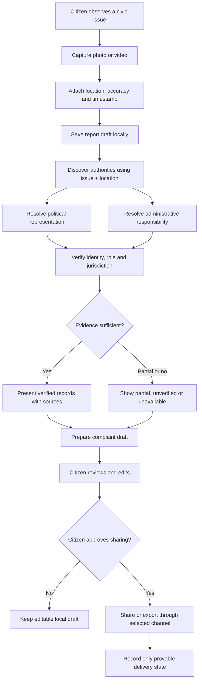
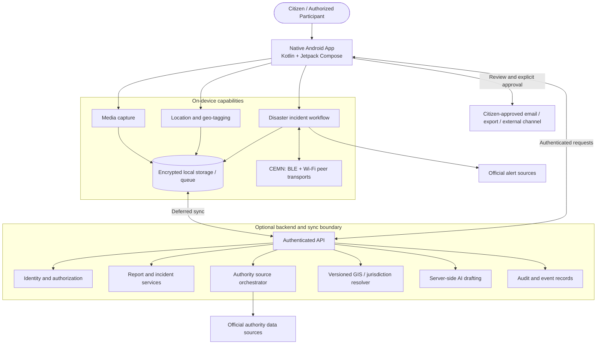

# CityFix

**See the problem. Report it. Reach the responsible authority.**

CityFix is an Android-only civic reporting and disaster-management platform designed to connect citizen-reported problems with the public authorities responsible for them. It combines evidence capture, geolocation, live authority discovery, identity and jurisdiction verification, citizen-reviewed complaint preparation, and a separate disaster-management system with an Android-phone-based emergency coordination network.

CityFix is not intended to be another form that merely collects a complaint and stops there. Its design connects the full civic reporting path—from observing a problem to identifying the appropriate public office—with a distinct offline-capable incident coordination path for emergencies.

> **Important boundary:** CityFix supports reporting, information discovery, preparedness, and coordination. It does not dispatch emergency services, guarantee government action, or claim that a complaint has been officially registered, acknowledged, or resolved unless a real external integration proves that state.

---

## Contents

- [Why CityFix](#why-cityfix)
- [What makes CityFix different](#what-makes-cityfix-different)
- [Product scope](#product-scope)
- [Civic reporting workflow](#civic-reporting-workflow)
- [Authority discovery and verification](#authority-discovery-and-verification)
- [Complaint generation and delivery semantics](#complaint-generation-and-delivery-semantics)
- [Disaster Management](#disaster-management)
- [CityFix Emergency Mesh Network (CEMN)](#cityfix-emergency-mesh-network-cemn)
- [System architecture](#system-architecture)
- [Trust, privacy, and security](#trust-privacy-and-security)
- [Technology direction](#technology-direction)
- [Repository structure](#repository-structure)
- [Implementation status](#implementation-status)
- [Build and development](#build-and-development)
- [Validation and acceptance scenarios](#validation-and-acceptance-scenarios)
- [Documentation](#documentation)
- [Project principles and limitations](#project-principles-and-limitations)

## Why CityFix

Citizens can often identify a local problem but cannot easily determine which department, elected representative, administrative office, or official is responsible for it. Authority information may be fragmented across portals and documents, while jurisdiction boundaries and contact details can change. A complaint form alone does not solve the authority-discovery problem.

Emergencies create a different problem: internet connectivity may be intermittent or unavailable precisely when people need to share incident information. A conventional online-only workflow cannot be assumed to remain available.

CityFix addresses these problems through two connected but distinct product areas:

1. **Civic accountability:** document a local issue, establish its geographic context, identify the relevant political and administrative authorities, verify available records, and prepare a complaint the citizen can review.
2. **Disaster management:** create structured incident reports, surface verified emergency information, and support local device-to-device coordination when normal connectivity is disrupted.

## What makes CityFix different

CityFix is designed around the complete workflow and the reliability of the information—not just complaint submission.

| Common limitation in a basic reporting workflow | CityFix design objective |
|---|---|
| Collects a complaint but leaves the citizen to find the correct office | Resolve authority candidates from issue type and location |
| Treats elected representatives and implementing departments as interchangeable | Separates political representation from administrative responsibility |
| Shows a static list of names and phone numbers | Retrieves attributable records and exposes source, freshness, and verification status |
| Treats a generated message as a submitted complaint | Separates draft, citizen approval, handoff, receipt, acknowledgement, and resolution |
| Requires continuous internet access | Preserves local incident capture and queues synchronization |
| Treats emergency reporting as another form or chat feed | Uses a dedicated incident-management workflow and structured SOS records |
| Displays nearby devices as if that alone were a working mesh | Requires application-level routing, store-and-forward, deduplication, expiry, and delivery evidence |
| Treats every nearby user as a responder | Separates citizens, volunteers, verified responders, and official agency actions |

These are CityFix's intended product and engineering distinctions. They are not claims that every capability is already implemented or that no other product has similar features.

## Product scope

**Client scope:** native Android application only. There is no iOS application or CityFix web application in the current product scope. A public landing page is a separate project/buildathon deliverable, not a second application client.

### Civic reporting modules

1. **Photo and media capture**
   - Capture or select photo/video evidence.
   - Preview, remove, and choose which media to attach.
   - Preserve relevant capture metadata where available.
   - Keep media upload state separate from report state.

2. **Geo-tagging**
   - Attach coordinates with permission.
   - Preserve accuracy, timestamp, location age, and acquisition/provenance information.
   - Resolve jurisdiction only against configured, authoritative, versioned boundary data.
   - Allow a report draft to continue when location is denied or unavailable, while disclosing the limitation.

3. **Identity and authority discovery**
   - Retrieve relevant public authority records from live, attributable sources.
   - Identify both elected representatives and administrative authorities.
   - Resolve the relationship between issue category, department, office, and jurisdiction.

4. **Verification**
   - Verify identity, designation/role, role validity where available, jurisdiction, responsibility, and official contact details.
   - Retain source references, retrieval time, verification time, and limitations.
   - Return verified, partially verified, unverified, or unavailable results rather than filling gaps with guesses.

5. **Complaint preparation**
   - Assemble citizen description, issue category, location, media references, and authority context.
   - Use AI as an assistive drafting layer when configured.
   - Require the citizen to review and edit before sharing or exporting.

### Separate Disaster Management module

Disaster Management is not an ordinary civic complaint screen, a general chat room, or a social feed. It is a dedicated emergency information and incident-coordination capability covering:

- Structured citizen SOS and incident reporting.
- Location-aware situational awareness and offline map capability as implemented.
- A clear distinction between citizen-reported incidents and official government alerts.
- Verified emergency contacts and source-backed safety guidance.
- Preparedness information and incident-specific safety instructions.
- Local coordination and deferred synchronization during degraded connectivity.
- Explicit status for internet connectivity, peer connectivity, and message delivery.

CityFix does not replace emergency services, medical professionals, police, fire and rescue services, or official disaster-management authorities.

## Civic reporting workflow

The intended end-to-end flow is:



Authority discovery is not a prerequisite for preserving evidence. If official authority data or jurisdiction boundaries are unavailable, the citizen's report can remain a draft; CityFix must not invent an official to complete the workflow.

## Authority discovery and verification

CityFix keeps two authority dimensions separate:

- **Political representation — who represents this area?** Elected representatives associated with the relevant constituency or local-government area.
- **Administrative responsibility — who is responsible for this issue?** The department, office, agency, or public official with operational responsibility for the issue category and jurisdiction.

An authority lookup result is a candidate record, not automatically a verified identity.

A record should carry, where available:

- Canonical identity and designation.
- Office, department, and role.
- Role validity/effective dates.
- Jurisdiction and issue responsibility.
- Official contact information.
- Source URL or source identifier.
- Retrieval and verification timestamps.
- Verification outcome, confidence/limitations, and freshness.

**Live data is the intended source of truth.** A static local cache may improve availability, but it must carry provenance and freshness metadata and must never be silently presented as current official truth. If a source is unavailable, the system must return an explicit unavailable or partial result.

## Complaint generation and delivery semantics

AI may help transform a citizen's description into a clear, structured complaint. It may assist with categorization, summarization, translation, and drafting. It must not invent facts, officials, legal obligations, response deadlines, or government commitments.

The citizen remains the decision-maker:

1. Review the evidence and authority context.
2. Review and edit the generated complaint.
3. Explicitly approve the selected sharing action.
4. Choose an available channel, such as email handoff or document export.

These states are not interchangeable:

| State | What it proves |
|---|---|
| Draft | A complaint exists as editable content |
| Approved | The citizen approved the content for sharing |
| Handoff/send attempted | CityFix initiated the selected external action |
| Received | The target system or recipient provided a verifiable receipt |
| Acknowledged | The responsible recipient returned a verifiable acknowledgement |
| Resolved | An authorized workflow recorded resolution with evidence |

Opening an email composer, exporting a PDF, or generating a complaint does not prove official submission. Government ERP/API submission and acknowledgement can only be claimed after a real, configured integration confirms them.

## Disaster Management

The disaster module supports structured incident information and local coordination. It must distinguish the source and authority of every alert or status.

### Incident and SOS record

A structured SOS may contain:

- Stable incident/message identifier.
- Incident category and short description.
- GPS coordinates, accuracy, and capture timestamp when permission is granted.
- Optional photo/video evidence.
- Optional callback/contact information, subject to consent.
- Creation time, expiry, and delivery state.
- Origin and integrity/authentication metadata when implemented.

Precise location, contact information, and media must not be exposed indiscriminately. Nearby citizens may receive limited emergency details; privileged details are restricted to authorized responders under an implemented access policy.

### Recipient and trust classes

| Participant | Permitted meaning |
|---|---|
| Citizen | Creates or relays a citizen-reported incident |
| Volunteer | Offers or performs a clearly scoped volunteer action |
| Verified responder | Holds an authenticated, authorized responder role |
| Official agency | Acts only through a real configured official channel or integration |

A nearby phone is not automatically a responder. An unverified device cannot claim official status, issue authoritative evacuation instructions, acknowledge on behalf of an agency, or close an incident.

### Incident lifecycle

```text
SOS created
  → queued locally
  → relayed by a peer (if a valid transport exists)
  → received by a target device/service
  → acknowledged by an authorized responder
  → response in progress (only with evidence)
  → resolved with evidence (only by an authorized workflow)
```

A relay is not proof of final delivery. Receipt is not proof of acknowledgement. Acknowledgement is not proof of rescue or resolution.

## CityFix Emergency Mesh Network (CEMN)

CEMN is the Android-phone-to-Android-phone communication layer for structured emergency coordination when ordinary internet connectivity is degraded or unavailable. It is an application-level store-and-forward system, not simply a Bluetooth connection indicator.

### Transport model

- **Bluetooth Low Energy (BLE):** nearby discovery and suitable low-bandwidth exchanges.
- **Wi-Fi Direct:** peer-to-peer data transfer where supported.
- **Wi-Fi Aware:** peer discovery/data paths where device and OS support are available.
- **Local persistence:** durable incident/message queue for retry and deferred synchronization.
- **Optional backend sync gateway:** synchronizes records when internet becomes available; it is not a prerequisite for local peer communication.

Android radio APIs provide links, not a complete multi-hop mesh. CEMN must implement the application-level protocol:

- Stable message and incident IDs.
- Typed and versioned message schemas.
- Origin authentication and integrity protection.
- Encryption and authorization appropriate to the recipient.
- TTL/expiry and queue limits.
- Duplicate suppression and idempotent processing.
- Routing and store-and-forward behavior.
- Receive and acknowledgement semantics.
- Reconnection and synchronization without duplicate incidents.
- Audit-friendly state transitions.

### Operating modes

| Mode | Meaning |
|---|---|
| Connected | Internet-backed services are available; local peer capability is tracked separately |
| Degraded | Internet is intermittent or unavailable; locally available peer transport and queued synchronization may be used |
| Disconnected | No usable internet path; local mesh operation is possible only if compatible peers and transports are actually available |

**Internet availability and mesh availability are independent state dimensions.** No internet does not mean that a mesh exists. A BLE adapter being present does not mean a peer is connected or a message can be delivered.

### Android platform constraints

- Android devices only; no dedicated LoRa hardware or external mesh gateway is part of the design.
- Wi-Fi Aware is not supported on every Android device.
- BLE and Wi-Fi behavior varies by hardware, OS version, permissions, radio state, and environment.
- Background execution, battery optimization, process death, and permission revocation can interrupt discovery and relay.
- Continuous background relay cannot be guaranteed.
- UI must show actual permission, radio, peer, queue, and delivery states—not simulated peer counts or optimistic status labels.

## System architecture

### High-level component flow



The backend is an optional synchronization and integration boundary for local emergency communication. Local incident capture and peer communication must not depend on a live backend.

### Backend deployment model

The target backend is a **modular monolith**, not a distributed microservice fleet. It keeps operational complexity low while enforcing internal domain boundaries.

Target bounded modules:

- `identity` — authentication, account lifecycle, role assignment.
- `authority` — source connectors and authority record normalization.
- `jurisdiction` — versioned geographic boundaries and resolution.
- `reports` — civic report drafts, approvals, and sharing state.
- `media` — upload authorization, metadata, retention, and access.
- `disaster` — incident and SOS lifecycle.
- `cemn` — optional synchronization, event ingestion, and relay metadata.
- `ai` — server-side model calls and structured drafting.
- `notifications` — configured delivery providers and notification state.
- `audit` — provenance, privileged actions, and state-transition records.

### Android target package boundaries

The current client may keep a single Gradle application module while maintaining internal package boundaries. The following is the intended logical decomposition, not a claim that every entry already exists as a Gradle module:

```text
:app
:core:domain
:core:database
:core:media
:core:location
:core:network
:core:security
:core:mesh
  :discovery
  :transport
  :routing
  :message-queue
  :deduplication
  :synchronization
:feature:report
  :evidence
  :geotagging
  :authority-discovery
  :authority-verification
  :complaint
:feature:disaster
  :incident
  :sos
  :offline-map
  :alerts
  :emergency-resources
  :rescue-coordination
:data
:integrations
  :gis-provider
  :authority-sources
  :ai-drafting
```

### Important data boundaries

- Citizen input and media are untrusted until validated.
- GPS is a device observation with accuracy and freshness limits.
- Authority records are external claims until verified against attributable sources.
- AI output is draft content, not authoritative evidence.
- Peer messages are untrusted until schema, authenticity, integrity, expiry, and authorization checks pass.
- External email/export handoff is not government acknowledgement.

## Trust, privacy, and security

Security and privacy are architectural requirements, not optional presentation features.

- Request camera, media, location, and nearby-device permissions only when needed and explain why.
- Do not silently substitute default coordinates or fabricate a jurisdiction.
- Share precise location, contact details, and media only through explicit, purpose-bound actions and authorized workflows.
- Keep citizen reports, volunteer actions, verified responder actions, and official agency actions distinct.
- Enforce authentication and server-side authorization for protected report and responder operations.
- Assign elevated responder/coordinator roles through a trusted administrative process, not user-controlled profile fields.
- Keep Gemini and other provider credentials on the server; never embed secrets in the APK or browser bundle.
- Apply schema validation, quotas, rate limits, abuse controls, secure transport, and audit logging before production exposure.
- Retain source provenance and freshness for authority data and official alerts.
- Minimize personal-data collection and define retention/deletion policies.
- Label sample, synthetic, stale, partial, and unverified information.
- Do not infer operational success from a build, API response, radio capability, or UI state.

### AI responsibility boundary

AI may assist with issue classification, description structuring, complaint drafting, translation, and summarization of source-backed information. Deterministic application logic and attributable sources must control identity verification, jurisdiction, authorization, routing, message delivery, official alert status, and incident resolution. AI must not independently certify officials, responders, or emergency outcomes.

## Technology direction

| Area | Direction |
|---|---|
| Android client | Kotlin, Jetpack Compose, Material 3 |
| Local persistence | Room; encrypted storage for sensitive data where required |
| Media | CameraX and Android media APIs |
| Location | Android location APIs with accuracy/freshness metadata |
| Deferred work | WorkManager for eligible deferred synchronization |
| Nearby transport | BLE, Wi-Fi Direct, Wi-Fi Aware with capability detection |
| Mesh protocol | Application-level typed messages, queues, routing, TTL, deduplication, acknowledgements, security |
| Backend | Existing Express/TypeScript server, organized as a modular monolith |
| AI | Gemini through server-side integration only |
| Geographic data | Authoritative GIS/jurisdiction boundaries with versioning |
| Authority data | Live official sources/connectors with provenance and freshness |
| Testing | Unit/contract/integration tests plus real multi-device Android tests |

Technology choices are subject to repository implementation and compatibility checks. A listed technology is a direction, not proof of an integrated production dependency.

## Repository structure

Relevant areas in this repository:

```text
.
├── android/                         # Native Android client foundation
├── docs/
│   ├── ARCHITECTURE.md              # Detailed logical architecture
│   ├── DIAGRAMS.md                  # Mermaid architecture and workflow diagrams
│   ├── architecture/
│   │   └── disaster-management-gps-cemn.md
│   └── security/
│       └── implementation-baseline.md
├── .github/workflows/               # CI workflows
└── README.md
```

The repository also contains an earlier browser-based interface prototype/reference. It is not the supported product client and prototype screens must not be treated as evidence of live backend, authority, alert, or mesh behavior.

## Implementation status

The status below distinguishes existing foundations from intended capabilities. Update it whenever code and tests change.

| Capability | Current status |
|---|---|
| Android native application foundation | Kotlin/Compose foundation exists |
| Local SOS creation and persistence | Implemented in the Android foundation |
| Location permission and capability handling | Foundation exists; location freshness/accuracy semantics require validation |
| BLE hardware/adapter capability inspection | Implemented; this is not peer discovery or message relay |
| Photo/video capture workflow | Product requirement; end-to-end native implementation must be verified |
| Live authority source integrations | Not configured/complete |
| Versioned authoritative jurisdiction/GIS data | Not configured/complete |
| Authority identity/role/contact verification | Target workflow; live verification connectors incomplete |
| Citizen-reviewed complaint drafting | Target workflow; verify configured AI and sharing path before claiming operational |
| Firebase-backed authentication/report controls | Present in the current server baseline; requires further security review and production hardening |
| Gemini server integration | Conditional on server-side configuration; output remains a draft |
| BLE/Wi-Fi peer discovery and transport | Not yet demonstrated end to end |
| Multi-hop CEMN routing/store-and-forward | Not yet demonstrated end to end |
| Message signing/encryption and responder authentication | Not yet demonstrated end to end |
| Official agency integrations and dispatch | Not implemented |
| Official receipt/acknowledgement/resolution | Not available without a real integrated authority workflow |
| Offline maps and operational field coordination | Target capability; verify implementation before claiming complete |

A successful TypeScript check, APK assembly, or UI demonstration does not prove physical-device radio behavior, multi-hop delivery, source verification, agency integration, or production security.

## Build and development

This section takes a contributor from a fresh Git clone to a locally built APK and a downloadable GitHub Actions artifact. It is a quick walkthrough; the [complete Windows setup guide](docs/ANDROID_SETUP_AND_RELEASE_GUIDE.md) contains screenshots/navigation details, SDK configuration, troubleshooting, device setup, and the full maintainer release checklist.

### 1. Clone the repository

Install Git, JDK 17, Android Studio, and the Android SDK first. The complete guide lists the exact versions and installation steps.

Open PowerShell and choose a workspace directory:

```powershell
New-Item -ItemType Directory -Force D:\Workspace | Out-Null
Set-Location D:\Workspace
git clone https://github.com/souravsviswajith/cityfix.git
Set-Location .\cityfix
```

If the repository is private, sign in to GitHub when Git requests authentication. Do not put a password or token in the clone URL.

Confirm the checkout:

```powershell
git status
git branch --show-current
```

The default branch is `main`. Start a task branch before making changes:

```powershell
git switch -c feature/short-task-name
```

### 2. Confirm the required toolchain

The current Android project configuration is:

| Component | Required version |
|---|---|
| JDK | 17 |
| Android SDK Platform | 35 |
| Android Build Tools | 35.0.0 |
| Android Gradle Plugin | 8.7.3 |
| Kotlin | 2.0.21 |
| Gradle | 8.9 |
| Minimum Android version | API 26 (Android 8.0) |

Verify Java and Gradle in PowerShell:

```powershell
java -version
javac -version
gradle --version
```

Java and the JVM reported by Gradle must be version 17. This repository currently has **no committed Gradle Wrapper** (`gradlew` / `gradlew.bat`), so install Gradle 8.9 and use the `gradle` command. Do not use `gradlew` until wrapper files are committed.

### 3. Install and configure Android SDK packages

In Android Studio:

1. Open **More Actions → SDK Manager** (or **Tools → SDK Manager** in an open project).
2. Under **SDK Platforms**, install **Android 15.0 / API 35**.
3. Under **SDK Tools**, install **Android SDK Build-Tools 35.0.0**, **Android SDK Platform-Tools**, and **Android SDK Command-line Tools (latest)**.
4. Apply the changes and accept the licences.
5. Note the Android SDK Location shown at the top of SDK Manager.

Set `ANDROID_HOME` to that exact location. Example only (use your actual SDK path):

```powershell
[Environment]::SetEnvironmentVariable("ANDROID_HOME", "$env:LOCALAPPDATA\Android\Sdk", "User")
```

Add these entries to the user PATH if they are not already present:

```text
%ANDROID_HOME%\platform-tools
%ANDROID_HOME%\cmdline-tools\latest\bin
```

Close and reopen PowerShell, then verify:

```powershell
adb version
sdkmanager --version
sdkmanager --list
```

If SDK Manager installed the packages but command-line tools cannot find them, re-check `ANDROID_HOME` and the actual SDK location before changing project files.

### 4. Open and sync the Android project

1. Start Android Studio.
2. Select **Open**.
3. Choose the repository's `android` directory (not the repository root).
4. Allow Gradle sync to complete.
5. Open **File → Settings → Build, Execution, Deployment → Build Tools → Gradle**.
6. Set **Gradle JDK** to JDK 17.
7. Confirm the project sync completes without changing the Android Gradle Plugin, Kotlin, SDK, or Gradle versions.

The native application source is under `android/`. The older browser prototype is not the supported Android client.

### 5. Run CityFix on an emulator or Android phone

**Emulator**

1. In Android Studio, open **Tools → Device Manager**.
2. Create a virtual device using a compatible Android image (API 26 or later; API 35 is suitable for current-target testing).
3. Start the emulator.
4. Select it in the run-device selector and click **Run**.

**Physical Android phone**

1. Enable Developer options on the phone.
2. Enable **USB debugging**.
3. Connect the phone with a data-capable USB cable.
4. Unlock the phone and accept the RSA debugging prompt.
5. In PowerShell, run:

```powershell
adb devices
```

The device should appear with status `device`, not `unauthorized`. Then run the app from Android Studio.

Grant permissions only when prompted and only for the feature being tested. A locally saved SOS is not proof that another phone, responder, or authority received it. BLE capability inspection is not a working multi-hop mesh.

### 6. Build a debug APK locally

From the repository root:

```powershell
Set-Location .\android
gradle :app:clean
gradle :app:assembleDebug
Set-Location ..
```

Wait for `BUILD SUCCESSFUL`. The APK should exist at:

```text
android\app\build\outputs\apk\debug\app-debug.apk
```

Verify the APK and calculate its SHA-256 checksum:

```powershell
Test-Path .\android\app\build\outputs\apk\debug\app-debug.apk
Get-FileHash .\android\app\build\outputs\apk\debug\app-debug.apk -Algorithm SHA256
```

Install it on a connected, authorized device:

```powershell
adb install -r .\android\app\build\outputs\apk\debug\app-debug.apk
```

This is a **debug build for development/testing**, not a production-signed application.

### 7. Push your branch and open a pull request

Before pushing, inspect and validate your changes:

```powershell
git diff --check
git status
git diff
```

Stage only the files you intended to change:

```powershell
git add path\to\changed-file
git commit -m "feat(android): describe the change"
git push -u origin HEAD
```

Open a pull request from your branch into `main`. Do not push directly to `main`. The Android Actions workflow runs for pull requests that change `android/**` or the Android workflow file.

### 8. Download the GitHub Actions APK artifact

The repository workflow is **Android build** (`.github/workflows/android.yml`). It assembles a debug APK, creates a SHA-256 checksum, and uploads both as the artifact `cityfix-debug-apk` with a 14-day retention period.

To run it manually:

1. Open [CityFix Actions](https://github.com/souravsviswajith/cityfix/actions).
2. Select **Android build**.
3. Click **Run workflow**.
4. Select the branch to build and confirm **Run workflow**.
5. Open the new run and wait for the build job to finish successfully.
6. In the run summary, find **Artifacts**.
7. Download `cityfix-debug-apk` and extract the ZIP.
8. Confirm the archive contains `app-debug.apk` and `app-debug.apk.sha256`.

Verify the downloaded checksum in PowerShell from the extracted folder:

```powershell
Get-FileHash .\app-debug.apk -Algorithm SHA256
Get-Content .\app-debug.apk.sha256
```

The hash values must match. The artifact is a temporary CI output tied to a workflow run and commit; it is not a GitHub Release or production distribution.

### 9. Publish a maintainer-approved GitHub test release

A maintainer may attach a validated debug APK to a clearly labelled **pre-release** for internal testing:

1. Confirm the source commit has passed the required review and CI build.
2. Download the APK and checksum from that exact successful workflow run.
3. Open [CityFix Releases](https://github.com/souravsviswajith/cityfix/releases).
4. Select **Draft a new release**.
5. Create or select an approved tag (for example, `v0.1.0-test.1` only if that version is approved).
6. Use a title that identifies it as an internal/test build.
7. Mark **Set as a pre-release**.
8. Attach `app-debug.apk` and `app-debug.apk.sha256`.
9. Include the source commit, workflow run, build type, known limitations, and test instructions in the release notes.
10. Review the files and notes, then publish.

**Do not call this a production release.** The current repository workflow builds a debug APK only. Production signing, a signed release variant, automated GitHub Release publishing, and Play Store distribution are not configured or verified. Never commit a keystore or signing credentials.

For the full novice-first walkthrough and troubleshooting, continue with [Android Setup, Build & Artifact Release Guide](docs/ANDROID_SETUP_AND_RELEASE_GUIDE.md).

## Backend and provider configuration

Provider-backed capabilities must remain disabled or return explicit unavailable states until the required configuration, authentication, authorization, and source validation are in place.

- Firebase configuration is required for the current authentication/report path.
- Configure `GEMINI_API_KEY` and `GEMINI_MODEL` only in the server environment if Gemini drafting is enabled.
- Government authority and GIS connectors must use attributable official sources and versioned boundary data.
- SMS/WhatsApp OTP requires a configured provider; WhatsApp requires approved Meta Business configuration and credentials.
- Agency notifications or delivery require a real approved integration or verified operational channel.

Never place credentials in source control, app resources, or client-side bundles.

## Validation and acceptance scenarios

### Civic reporting

- Capture a report with and without media.
- Deny location permission and confirm that the report remains a draft with a clear location limitation.
- Confirm no fallback coordinates are silently substituted.
- Test issue + jurisdiction resolution against known versioned boundary fixtures.
- Verify that political and administrative authority records remain distinct.
- Test verified, partially verified, stale, unavailable, and conflicting source records.
- Confirm citizen review is required before sharing.
- Confirm a handoff is not displayed as official receipt or acknowledgement.

### CEMN minimum three-device test

1. Prepare three compatible Android phones: A, B, and C.
2. Disable internet on all three phones.
3. Phone A creates a structured SOS incident.
4. Phone B receives and relays the message using the implemented peer transport.
5. Phone C receives the same incident.
6. Verify stable IDs, integrity checks, TTL, duplicate suppression, and actual delivery states.
7. Restore internet and synchronize queued records without creating duplicate incidents.
8. Repeat with expired messages, missing permissions, unsupported transports, process termination, and reconnection.

A JVM unit test cannot prove Bluetooth/Wi-Fi radio behavior, Android lifecycle behavior, or real multi-hop delivery. Those require physical-device tests and recorded build/device details.

### Emergency safety and trust

- Distinguish citizen-generated reports from official alerts.
- Verify emergency contacts and safety guidance against current authoritative sources.
- Confirm that only authorized responders can acknowledge privileged workflows or close incidents.
- Confirm that a relay, receipt, acknowledgement, and resolution are separate states.
- Confirm that emergency dial actions launch the appropriate system dial intent when implemented.


## Build artifacts and release options

CityFix can distribute build outputs through GitHub without treating every CI build as a public release. These are **distribution options**, not a claim that a signed production release pipeline is currently configured.

### Option 1 — CI workflow artifact

Use GitHub Actions to upload the Android debug APK (and, where useful, test reports) as a workflow artifact after a successful build.

- Intended for developer review, QA, and short-lived testing.
- Tied to a specific workflow run and commit.
- Retention follows the repository's GitHub Actions artifact-retention settings.
- Not a versioned public release and not suitable as a production distribution channel.
- A debug APK must be labelled as a development/test build.

### Option 2 — GitHub Release asset

For a deliberate versioned distribution, create a Git tag and GitHub Release and attach a validated Android APK. A release workflow may build the APK from the tagged commit and upload it to the Release.

Before publishing a production-facing APK:
1. Use a release build variant.
2. Sign with a protected Android upload/release keystore; keep passwords and signing material in protected GitHub Actions secrets or a controlled signing environment.
3. Never commit keystores, passwords, service credentials, or API keys.
4. Run the required CI checks and device acceptance tests for the capabilities being advertised.
5. Generate and publish a SHA-256 checksum; retain the source commit/tag and build provenance.
6. Document version, supported Android range, known limitations, permissions, and whether the artifact is debug, internal-test, or production-signed.
7. Do not claim Play Store availability or official emergency capability unless separately released and verified.

### Option 3 — Other distribution channels

Google Play internal/closed testing or another controlled Android distribution channel may be considered later. This requires the appropriate application signing, store configuration, privacy disclosures, review, and release ownership. It is not required for local development.

### Current release status

- Android application version is currently `0.1.0` with `versionCode 1`.
- The repository's Android workflows currently assemble a debug APK; this is not a signed production release.
- No verified production signing configuration or public CityFix Android release is documented.
- The repository contains generic Gradle template workflows that refer to a Gradle Wrapper and a `publish` task not present in the Android project. Do not treat those templates as a working CityFix release pipeline.
- No GitHub Release publication should be considered configured until a dedicated workflow is implemented, exercised against a test tag, and its uploaded asset verified.

## Documentation

- [System architecture](docs/ARCHITECTURE.md) — functional modules, logical layers, workflows, trust boundaries, and implementation status.
- [Architecture diagrams and flowcharts](docs/DIAGRAMS.md) — system context, civic reporting, authority verification, CEMN delivery, and trust boundaries.
- [Disaster Management, GPS, and CEMN architecture](docs/architecture/disaster-management-gps-cemn.md) — offline-first emergency coordination and Android mesh constraints.
- [Security and implementation baseline](docs/security/implementation-baseline.md) — current security controls, limitations, and required hardening.

## Project principles and limitations

1. **Truth over appearance:** never display a simulated capability as live.
2. **Evidence over assumption:** retain source, timestamp, accuracy, and verification status.
3. **Citizen control:** the citizen reviews and approves complaint content and sharing.
4. **Authority clarity:** political representation is not the same as administrative responsibility.
5. **Offline resilience:** local capture and peer communication should not require a backend to be online.
6. **Explicit trust:** citizens, volunteers, verified responders, and agencies have different permissions.
7. **Least privilege:** disclose only the data needed for the selected workflow.
8. **Graceful degradation:** unavailable sources, permissions, or transports must produce honest states.
9. **Test the real system:** hardware-dependent behavior requires real-device validation.
10. **No false promises:** CityFix does not claim government action, emergency dispatch, rescue, or incident resolution without verifiable integration evidence.

## Project

**CityFix**  
*See the problem. Report it. Reach the responsible authority.*

Developed for the Tutedude Buildathon. Demonstrations must clearly distinguish implemented functionality from prototypes, simulations, and planned integrations.
