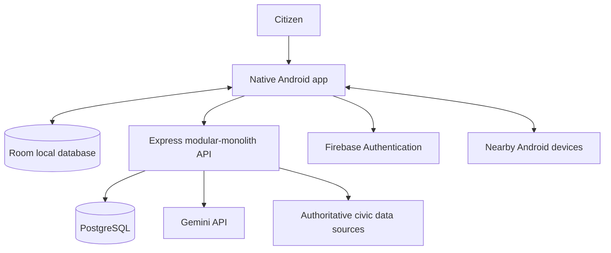

# CityFix

**See the problem. Report it. Reach the responsible authority.**

CityFix is an Android-first civic reporting and disaster-awareness platform. It helps citizens document local problems, identify the public authority responsible for an issue, and prepare evidence-backed complaints. Its disaster-management capability is designed to support location-aware incident reporting and local coordination when connectivity is degraded.

> **Important:** CityFix is a citizen reporting and coordination tool. It is not an emergency dispatch service and does not guarantee government action, official complaint registration, acknowledgement, or resolution.

## Table of Contents

1. [About CityFix](#about-cityfix)
2. [Core Features](#core-features)
3. [Technology Stack](#technology-stack)
4. [Getting Started](#getting-started)
   - [Prerequisites](#prerequisites)
   - [Clone the Repository](#clone-the-repository)
   - [Run the Android Application](#run-the-android-application)
   - [Run the Browser Prototype and API](#run-the-browser-prototype-and-api)
   - [Environment Configuration](#environment-configuration)
   - [Google Maps API Key](#google-maps-api-key)
5. [Dependencies](#dependencies)
6. [Project Structure](#project-structure)
   - [Android Application](#android-application)
   - [Browser Application](#browser-application)
   - [Backend and Database](#backend-and-database)
   - [Documentation and Assets](#documentation-and-assets)
7. [Architecture and Workflows](#architecture-and-workflows)
8. [Implementation Status and Limitations](#implementation-status-and-limitations)
9. [Development and Contribution](#development-and-contribution)
10. [Resources for Learning](#resources-for-learning)
11. [License](#license)

## About CityFix

Reporting a civic issue often requires citizens to identify which department, office, or public representative is responsible for a particular location and problem. That information can be fragmented, difficult to verify, or out of date. During emergencies, unreliable connectivity can make it harder to share incident information and coordinate locally.

CityFix aims to reduce these barriers through location-aware reporting, authority discovery, structured complaint preparation, and resilient local communication.

The project has two distinct application surfaces:

- **Native Android application:** the primary mobile product, built with Kotlin and Jetpack Compose.
- **Browser prototype:** a separate React and TypeScript implementation used for prototyping and selected web-based workflows. It is not the native Android application.

## Core Features

### 1. Civic Issue Reporting

- Capture or select photographs and videos documenting a civic issue.
- Attach geographic coordinates with the citizen's permission.
- Record issue category, description, time, and supporting evidence.
- Keep the citizen in control of the report and its sharing.

### 2. Geo-tagging and Location Context

- Associate a report with available device location information.
- Use location context to help identify the relevant geographic jurisdiction.
- Distinguish a fresh location fix from a cached or unavailable location.
- Avoid assigning a ward, district, or authority when the available evidence does not support it.

### 3. Public Authority Discovery

CityFix separates two different questions:

- **Political representation:** Who represents this area?
- **Administrative responsibility:** Which department, office, or official is responsible for this issue?

Authority information must be attributable to a source. A result should retain its source, retrieval time, geographic scope, and verification status. If authoritative data is unavailable, CityFix should report that limitation rather than inventing officials, departments, jurisdictions, or contact details.

### 4. Complaint Draft Generation

- Prepare structured complaint drafts from citizen-provided details.
- Include issue description, location, evidence references, and relevant authority information where verified.
- Allow the citizen to review and edit generated content before sharing.
- Support appropriate export or sharing channels where available.

AI may assist with classification, translation, summarization, and drafting. AI output is advisory: it cannot establish official identity, determine authorization, submit an official complaint, or confirm resolution.

A generated draft is not proof of official submission or acknowledgement.

### 5. Disaster Management

The disaster-management module is intended to support incident reporting and local coordination. Its scope includes:

- Location-aware incident reporting and situational awareness.
- Clear separation of citizen-reported incidents and official alerts.
- Verified emergency contact information and reviewed safety guidance.
- Preparedness information and location-relevant guidance.
- Local coordination when internet connectivity is degraded or unavailable.

CityFix does not replace emergency services, medical professionals, or official disaster-management agencies. Do not rely on the application as the sole channel for urgent emergency assistance.

### 6. CityFix Emergency Mesh Network (CEMN)

CEMN is the planned Android-phone-to-Android-phone communication layer for local coordination when normal connectivity is disrupted.

**Intended components:**

- Bluetooth Low Energy (BLE) for nearby device discovery and suitable low-bandwidth exchanges.
- Wi-Fi Direct or Wi-Fi Aware for peer communication where supported.
- Application-level routing and store-and-forward delivery.
- Local persistence and synchronization when connectivity returns.
- Message identity, expiry (TTL), duplicate suppression, acknowledgements, authentication, and encryption.

BLE and Wi-Fi provide transport capabilities; they do not automatically provide application-level multi-hop routing, trusted sender identity, deduplication, or delivery acknowledgements. Android background-execution and battery restrictions can interrupt discovery and relay. Continuous relay availability cannot be guaranteed.

A message lifecycle must distinguish **Queued → Relayed → Received → Acknowledged**. Relay is not receipt; receipt is not acknowledgement; acknowledgement is not official dispatch.

## Technology Stack

| Area | Technology |
|---|---|
| Native Android | Kotlin, Jetpack Compose |
| Android local persistence | Room |
| Android asynchronous operations | Kotlin Coroutines |
| Browser prototype | React 19, TypeScript, Vite |
| Styling | Tailwind CSS 4 |
| Backend API | Node.js, Express 5, TypeScript |
| Database | PostgreSQL |
| Database access and migrations | Drizzle ORM, Drizzle Kit |
| Authentication | Firebase Authentication, Firebase Admin |
| AI integration | Google Gemini API |
| Browser maps | Google Maps Platform, `@vis.gl/react-google-maps` |
| Charts and visualization | Recharts, Three.js |
| PDF generation | jsPDF |

Exact dependency versions are maintained in the repository manifests. The native Android application and browser/API project have separate build configurations.

## Getting Started

### Prerequisites

**For Android development**

- Windows 10/11, macOS, or Linux.
- Android Studio.
- JDK 17.
- Android SDK Platform 35.
- Android Build Tools 35.0.0.
- Gradle 8.9 for command-line builds when using the current checkout.
- Android emulator or physical Android device.
- 8 GB RAM minimum; 16 GB recommended for Android Studio and an emulator.

**For browser/API development**

- Node.js 22 LTS or a compatible supported Node.js release.
- npm.
- Git.
- PostgreSQL for database-backed backend features.
- Firebase project configuration and Application Default Credentials for Firebase Admin-backed routes.
- Gemini API key only if testing server-side AI features.

Installation resources:

- [Git](https://git-scm.com/downloads)
- [Node.js](https://nodejs.org/en/download)
- [Android Studio](https://developer.android.com/studio)
- [JDK 17 — Eclipse Temurin](https://adoptium.net/temurin/releases/?version=17)
- [Gradle](https://gradle.org/releases/)
- [Flutter is not required for this project.]

### Clone the Repository

Open a terminal or PowerShell window:

```bash
git clone https://github.com/souravsviswajith/cityfix.git
cd cityfix
```

### Run the Android Application

1. Open Android Studio.
2. Select **Open** and choose the repository's `android/` directory.
3. Open **Tools → SDK Manager** and install Android SDK Platform 35 and Build Tools 35.0.0.
4. Configure the Gradle JDK to use JDK 17.
5. Wait for Android Studio to finish Gradle sync.
6. Start an Android emulator or connect a physical Android device with USB debugging enabled.
7. Select the `app` run configuration and click **Run**.

The Android application configuration currently uses:

| Setting | Value |
|---|---|
| Application ID | `com.cityfix.android` |
| Minimum SDK | 26 |
| Compile SDK | 35 |
| Target SDK | 35 |
| Java / Kotlin JVM target | 17 |
| Android Gradle Plugin | 8.7.3 |
| Kotlin | 2.0.21 |

For a command-line debug build, from the repository root:

```powershell
Set-Location .\android
gradle :app:assembleDebug
Set-Location ..
```

**Gradle Wrapper note:** the current repository does not include `gradlew`, `gradlew.bat`, or `gradle/wrapper/`. Use a local Gradle 8.9 installation. Do not assume that `./gradlew` is available.

### Run the Browser Prototype and API

From the repository root:

```bash
npm install
```

Create a local environment file.

**Windows PowerShell**

```powershell
Copy-Item .env.example .env
```

**macOS / Linux**

```bash
cp .env.example .env
```

Configure the required values in `.env`, then start the development server:

```bash
npm run dev
```

The current development script starts the Express server through `tsx server.ts`. The example environment file specifies port 3000. Check the terminal output and use the health endpoint, when the server is running, to verify API availability:

```text
http://localhost:3000/api/health
```

Available scripts:

```bash
npm run dev
npm run typecheck
npm run lint
npm run build
npm run check
```

| Script | Purpose |
|---|---|
| `dev` | Start the Express development server |
| `typecheck` | Run TypeScript type checking |
| `lint` | Currently invokes the typecheck script; it is not a separate ESLint run |
| `build` | Build the Vite browser application |
| `check` | Run typecheck followed by the browser build |

**Package manager note:** the repository contains `bun.lock` and does not currently contain `package-lock.json`. npm can be used for local setup as shown above, but do not commit a newly generated lockfile without agreement from the maintainers.

### Environment Configuration

The committed `.env.example` currently contains:

| Variable | Purpose |
|---|---|
| `GEMINI_API_KEY` | Server-side Gemini API credential |
| `VITE_GOOGLE_MAPS_API_KEY` | Google Maps key exposed to the browser prototype |
| `PORT` | Example API port setting |

The database connection code also reads PostgreSQL configuration values:

- `SQL_HOST`
- `SQL_USER`
- `SQL_PASSWORD`
- `SQL_DB_NAME`

The Drizzle configuration additionally references:

- `SQL_ADMIN_USER`
- `SQL_ADMIN_PASSWORD`

These database variables are not all present in the current `.env.example`. Obtain the correct development values from the project maintainer; do not guess credentials or use production credentials.

Firebase Admin initialization uses Application Default Credentials. Follow the [Firebase Admin SDK setup guide](https://firebase.google.com/docs/admin/setup) for the local environment when working on authenticated server-side routes.

**Security rules**

- Never commit `.env`, service-account JSON, private keys, access tokens, or passwords.
- Values prefixed with `VITE_` are bundled into browser code. They are not secrets.
- Restrict Google Maps keys by API and allowed website referrers.
- Keep `GEMINI_API_KEY` on the server. Do not embed it in Android code or browser bundles.
- Use synthetic citizen/report data during development and demonstrations.

### Google Maps API Key

The existing Google Maps integration is in the **browser prototype**, including `src/components/CityFixGoogleMap.tsx`. It does not establish that a native Android Google Maps screen is implemented.

1. Open the [Google Cloud Console](https://console.cloud.google.com/).
2. Select the Google Cloud project used for the browser prototype.
3. Enable the Google Maps JavaScript API required by the web integration.
4. Create an API key.
5. Restrict the key to the required API and allowed development/production website referrers.
6. Add the key to your local `.env` file:

```dotenv
VITE_GOOGLE_MAPS_API_KEY=your_restricted_browser_maps_key
```

7. Restart the development server after changing environment variables.

Do not paste API keys into source files, screenshots, issues, or pull requests. Native Android Maps configuration should be documented separately if a native Maps SDK screen is added.

## Dependencies

The exact versions are defined in `package.json` and the Android Gradle build files.

### Browser and Backend Dependencies

- `react`, `react-dom`: browser user interface.
- `vite`, `@vitejs/plugin-react`: browser development and build tooling.
- `typescript`: static type checking.
- `tailwindcss`, `@tailwindcss/vite`: styling.
- `express`, `tsx`: API server and TypeScript execution.
- `firebase`, `firebase-admin`: Firebase client and server integration.
- `pg`, `drizzle-orm`, `drizzle-kit`: PostgreSQL access and schema tooling.
- `@google/genai`: Gemini API integration.
- `@vis.gl/react-google-maps`: browser map integration.
- `recharts`, `three`: data visualization.
- `jspdf`: PDF generation.
- `ws`: WebSocket support.

### Android Dependencies

- Jetpack Compose UI and Material 3.
- AndroidX Activity and Lifecycle.
- Room runtime and Room KTX.
- Kotlin Coroutines for Android.
- KSP for Room compiler processing.

Use the checked-in manifests as the source of truth when adding or upgrading dependencies. Do not copy version numbers from this README into build files.

## Project Structure

The following is a high-level guide to the repository. Individual files may evolve as the implementation develops.

```text
cityfix/
├── android/                              # Native Android application
│   ├── app/
│   │   ├── build.gradle.kts              # Android app configuration
│   │   └── src/main/
│   │       ├── AndroidManifest.xml
│   │       └── java/com/cityfix/android/
│   │           ├── MainActivity.kt
│   │           ├── data/                 # Room database, entities and DAO
│   │           ├── location/             # Device location access
│   │           └── mesh/                 # Current BLE capability checks
│   ├── build.gradle.kts
│   └── settings.gradle.kts
├── src/                                  # Browser prototype and API source
│   ├── components/                       # Browser UI components
│   ├── context/                          # React application contexts
│   ├── data/                             # Prototype/reference data
│   ├── db/                               # PostgreSQL, Drizzle schema and repository
│   ├── lib/                               # Firebase and shared utilities
│   ├── middleware/                       # Express middleware
│   ├── services/                         # Application service logic
│   ├── types/                             # TypeScript types
│   ├── App.tsx                            # Browser application root
│   └── main.tsx                           # Browser entry point
├── docs/
│   ├── architecture/                     # Architecture and workflow documentation
│   ├── security/                         # Security implementation baseline
│   └── TEAM_SETUP_GUIDE.md               # Beginner-friendly setup guide
├── public/                               # Static browser assets
├── .github/workflows/                    # CI and security workflows
├── .env.example                          # Example environment variables
├── package.json                          # Browser/API scripts and dependencies
├── server.ts                             # Express server entry point
├── bun.lock                              # Bun dependency lockfile
├── DOCUMENTATION.md                      # Documentation index
└── LICENSE                               # GNU General Public License v3
```

### Android Application

The native Android application is located in `android/`.

- `MainActivity.kt`: Android application entry point.
- `data/`: local Room database, incident entity, and DAO.
- `location/`: device location access.
- `mesh/`: current BLE capability inspection.

The Android client is the primary mobile application. Do not assume that a browser component or browser map feature is also available natively.

### Browser Application

The browser prototype is implemented under `src/`.

- `components/`: browser screens and reusable components, including map and reporting views.
- `context/`: React context providers and application state.
- `data/`: prototype data and reference content.
- `types/`: TypeScript types shared across browser/API code.
- `App.tsx` and `main.tsx`: browser application composition and entry point.

### Backend and Database

- `server.ts`: Express server entry point.
- `src/middleware/`: request middleware.
- `src/services/`: application service logic.
- `src/db/`: PostgreSQL connection, Drizzle schema, migrations, and repository operations.
- `src/lib/`: Firebase integration and shared utilities.

The backend is intended to remain a modular monolith. Do not introduce microservices without a demonstrated operational requirement.

### Documentation and Assets

- `docs/TEAM_SETUP_GUIDE.md`: step-by-step contributor onboarding.
- `docs/architecture/`: system architecture and workflow diagrams.
- `docs/security/implementation-baseline.md`: security controls and known gaps.
- `DOCUMENTATION.md`: documentation index.
- `public/`: static browser assets.

See [DOCUMENTATION.md](DOCUMENTATION.md) for the full documentation map.

## Architecture and Workflows

CityFix uses a modular-monolith backend and a native Android client. The React browser application is a separate prototype.

At a high level:



This is a logical architecture diagram. It does not imply that every integration or workflow is currently complete.

For detailed diagrams and implementation boundaries, read:

- [Documentation Index](DOCUMENTATION.md)
- [Architecture Overview](docs/architecture/overview.md)
- [Report, SOS, and CEMN Workflows](docs/architecture/workflows.md)
- [Disaster Management, GPS, and CEMN](docs/architecture/disaster-management-gps-cemn.md)
- [Team Setup Guide](docs/TEAM_SETUP_GUIDE.md)
- [Contribution Guide](docs/CONTRIBUTING.md)
- [Security Implementation Baseline](docs/security/implementation-baseline.md)

## Implementation Status and Limitations

The repository contains a React/TypeScript browser prototype and an initial native Android foundation. The following status distinctions are important:

| Capability | Current status |
|---|---|
| Native Android application | Kotlin + Jetpack Compose foundation |
| SOS capture | Local incident persistence using Room |
| Location | Recent cached location may be available; a fresh GPS fix is not guaranteed |
| BLE | Capability/adapter checks; full peer discovery and relay are not implemented |
| Wi-Fi Direct / Wi-Fi Aware | No complete peer transport workflow |
| CEMN multi-hop relay | Planned; no verified end-to-end three-device relay |
| Browser Google Maps | Integration exists in browser prototype |
| Native Android Google Maps | Not currently implemented |
| Authority directory and jurisdiction | Requires configured authoritative sources; unavailable when sources are not configured |
| Government ERP submission | No verified integration |
| Emergency dispatch | Not implemented |

Do not interpret prototype screens, sample records, peer counts, connection indicators, alert feeds, or delivery states as live operational data. Demonstrations must label synthetic data and simulated behavior. A feature should be described as complete only when its implementation and acceptance tests support that claim.

## Development and Contribution

1. Read the [Team Setup Guide](docs/TEAM_SETUP_GUIDE.md).
2. Read the [Architecture Overview](docs/architecture/overview.md).
3. Create a feature branch; do not work directly on `main`.
4. Keep changes focused and follow existing project conventions.
5. Run the relevant automated checks and manual tests.
6. Inspect the final diff for unrelated changes, secrets, and private data.
7. Open a pull request with implementation details, test evidence, and known limitations.

See [CONTRIBUTING.md](docs/CONTRIBUTING.md) for branch naming, commit conventions, security rules, pull request requirements, and the definition of done.

## Resources for Learning

### Android and Kotlin

- [Android Developers](https://developer.android.com/)
- [Kotlin Documentation](https://kotlinlang.org/docs/home.html)
- [Jetpack Compose](https://developer.android.com/develop/ui/compose)
- [Room Persistence Library](https://developer.android.com/training/data-storage/room)

### React and TypeScript

- [React Documentation](https://react.dev/learn)
- [TypeScript Handbook](https://www.typescriptlang.org/docs/)
- [Vite Guide](https://vite.dev/guide/)
- [Tailwind CSS Documentation](https://tailwindcss.com/docs)

### Backend and Database

- [Node.js Documentation](https://nodejs.org/docs/latest/api/)
- [Express Documentation](https://expressjs.com/)
- [PostgreSQL Documentation](https://www.postgresql.org/docs/)
- [Drizzle ORM Documentation](https://orm.drizzle.team/docs/overview)

### Firebase, Gemini, and Google Maps

- [Firebase Documentation](https://firebase.google.com/docs)
- [Firebase Admin SDK Setup](https://firebase.google.com/docs/admin/setup)
- [Google AI for Developers](https://ai.google.dev/gemini-api/docs)
- [Google Maps Platform Documentation](https://developers.google.com/maps/documentation)

## License

CityFix is distributed under the **GNU General Public License v3.0 (GPL-3.0)**. See the [LICENSE](LICENSE) file for the complete license terms.
