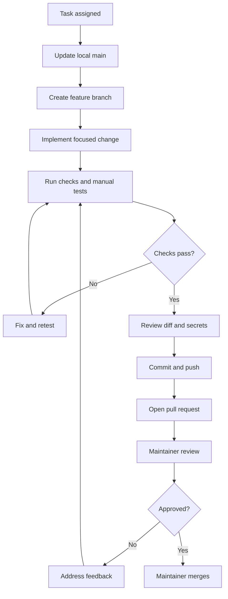

# Contributing to CityFix

This guide defines the standard contribution workflow. New contributors should first complete the [Team Setup Guide](TEAM_SETUP_GUIDE.md).

## 1. Before changing code

- Read the [README](../README.md) and [Architecture Overview](architecture/overview.md).
- Identify the exact issue or assigned task.
- Confirm whether the affected behavior is implemented, partial, or planned.
- Do not expand scope or change architecture without maintainer agreement.

## 2. Branch workflow

Never work directly on `main`.

```powershell
git switch main
git pull origin main
git switch -c feature/short-task-description
```

Use a descriptive branch prefix:
- `feature/` — new capability
- `fix/` — defect correction
- `docs/` — documentation
- `test/` — tests
- `chore/` — maintenance

## 3. Implementation rules

- Follow existing language, formatting, and package conventions.
- Prefer small, reviewable changes.
- Keep UI, domain logic, persistence, and transport responsibilities separated.
- Do not introduce microservices or new infrastructure without a demonstrated need.
- Do not make a client-controlled field authoritative.
- Do not use email addresses or hardcoded identities to grant privileged roles.
- Do not invent government officials, department contacts, or jurisdiction boundaries.
- Do not claim an external report was submitted or acknowledged without integration evidence.
- Keep AI-generated content advisory and subject to human review.
- Do not represent local SOS persistence as a broadcast or emergency dispatch.

## 4. Secrets and sensitive data

Never commit:
- `.env` files or API keys.
- Firebase service-account JSON or other private credentials.
- Access tokens, passwords, signing keys, or private certificates.
- Real citizen personal data, precise coordinates, or unredacted evidence.
- Screenshots containing private information.

If a secret is exposed, notify the maintainer immediately so it can be revoked or rotated. Removing it in a later commit does not make the exposed credential safe.

## 5. Validation

Run the checks relevant to the files changed.

### Browser/API

```powershell
npm run check
```

### Android

From the repository root:

```powershell
Set-Location .\android
gradle :app:assembleDebug
Set-Location ..
```

The repository has previously lacked committed Gradle Wrapper files; check the current repository before assuming `gradlew` exists. Known dependency-resolution failures should be reported with the full error, not bypassed by arbitrary version upgrades.

### Diff review

```powershell
git status
git diff --check
git diff
```

Review for unrelated edits, generated files, secrets, and personal data.

## 6. Commit conventions

Use a short imperative description with a conventional prefix:

```text
feat(android): add incident category validation
fix(api): enforce report ownership checks
docs: clarify local SOS persistence
test(cemn): cover duplicate packet rejection
```

Stage only the intended files.

```powershell
git add path/to/changed-file
git commit -m "docs: describe the change"
git push -u origin HEAD
```

## 7. Pull request requirements

Every PR should state:

1. **Summary:** what changed.
2. **Reason:** why it changed.
3. **Implementation:** relevant design choices.
4. **Validation:** commands and manual tests actually run.
5. **Limitations:** known gaps, unsupported devices, missing providers, or untested paths.
6. **Security/privacy impact:** especially for identity, location, media, reports, and CEMN.

Open the PR against `main`. Request review from the maintainer. Do not merge unless authorized.



## 8. Definition of done

- [ ] Scope matches the assigned task.
- [ ] Implementation follows existing architecture.
- [ ] Relevant automated checks pass, or failures are documented.
- [ ] Manual behavior is tested where applicable.
- [ ] Diff contains only intended changes.
- [ ] No secrets or private citizen data are included.
- [ ] Documentation and implementation status are updated.
- [ ] PR describes tests and limitations.
- [ ] Maintainer review is complete.
