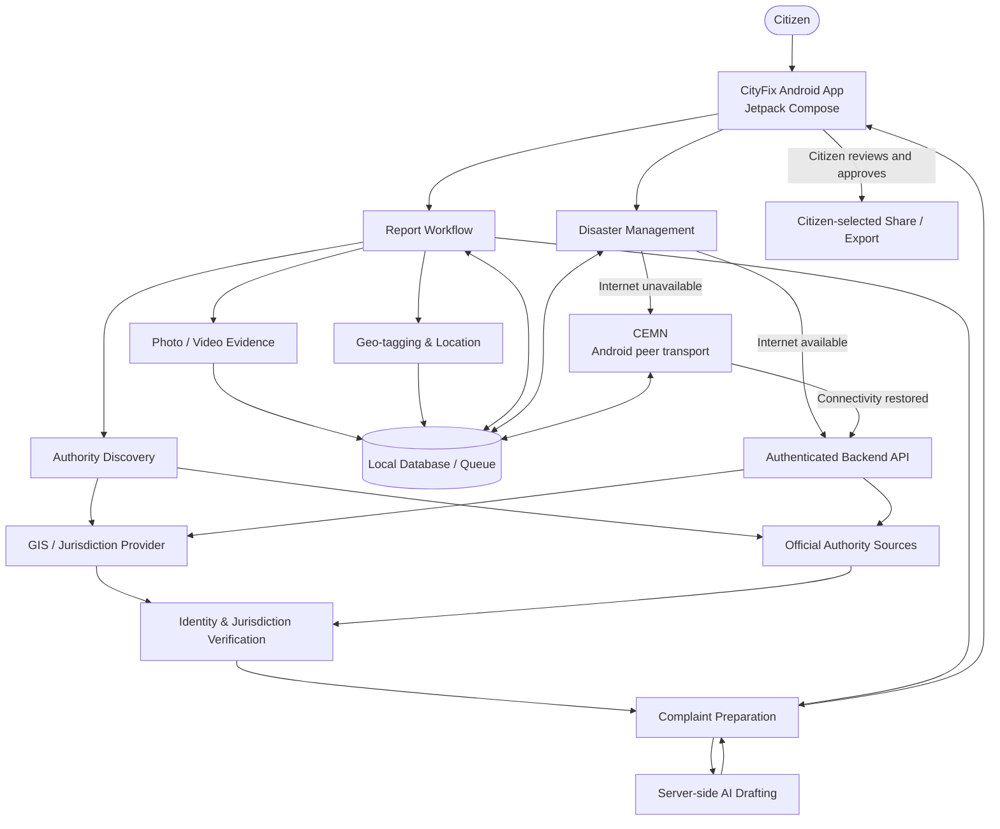
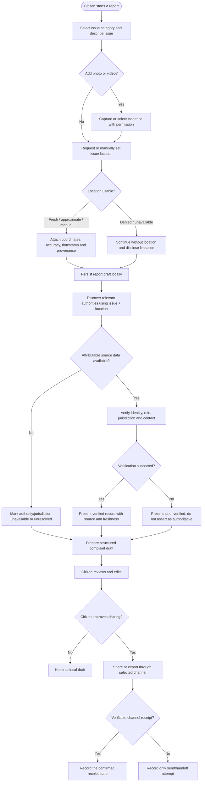
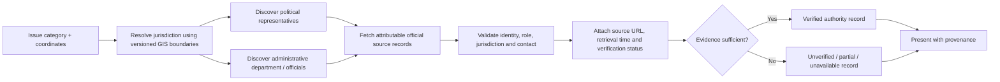
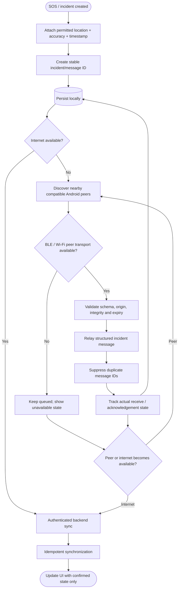
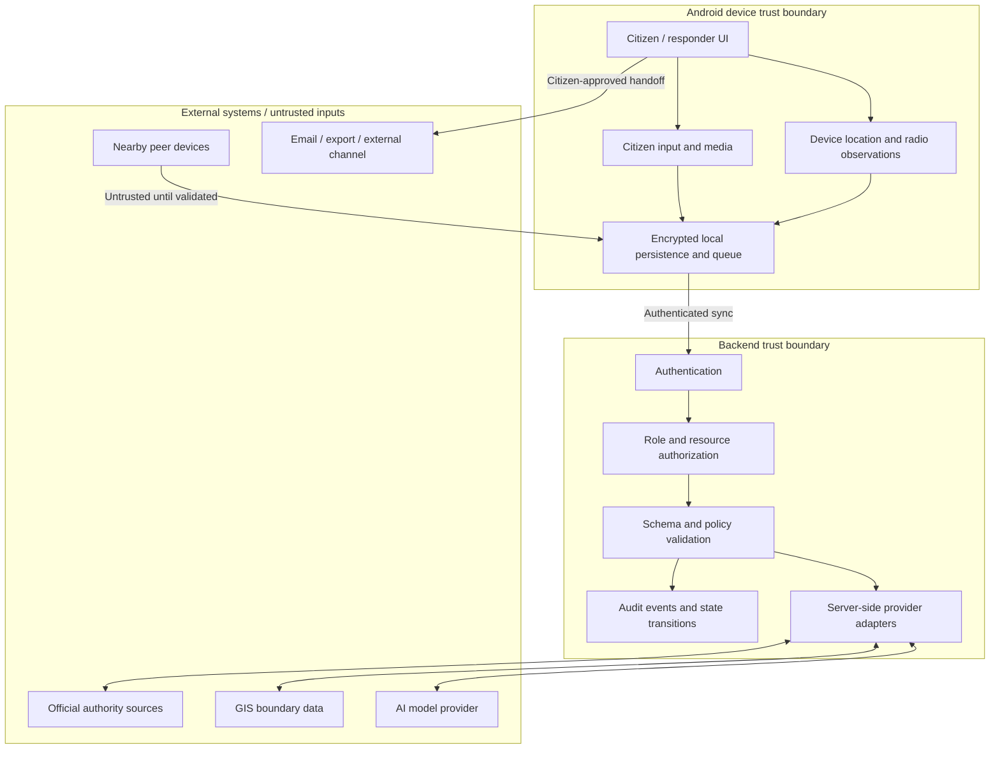

# CityFix Architecture Diagrams

These Mermaid diagrams describe the intended system workflows. They are architecture documentation, not proof that every component is implemented or deployed.

## 1. System context and component flow

## 2. Civic issue reporting flow

## 3. Authority discovery and verification

## 4. Disaster incident and CEMN delivery flow

## 5. Trust and authorization boundaries

## 6. Delivery-state semantics

| State | Meaning | Must not be interpreted as |
|---|---|---|
| Draft | Stored as an editable report/incident draft | Submitted |
| Queued | Persisted locally and waiting for a transport | Sent or received |
| Relayed | Forwarded by a peer or transport hop | Delivered to the final recipient |
| Received | A target device/service confirmed receipt | Read or acted upon |
| Acknowledged | An authorized recipient returned a verifiable acknowledgement | Resolved |
| Resolved | An authorized workflow recorded resolution with evidence | Automatically true after acknowledgement |

The UI and backend must use explicit state transitions and retain timestamps/provenance. Never infer a later state from an earlier one.
