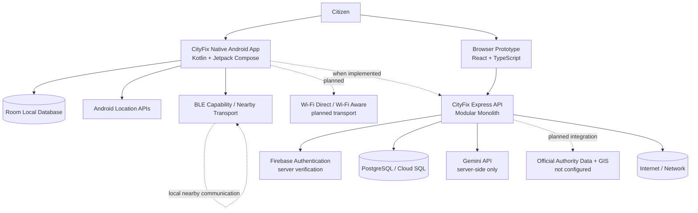
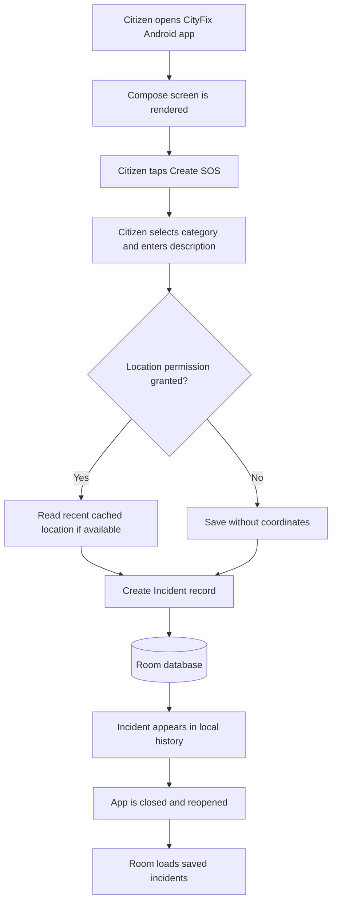
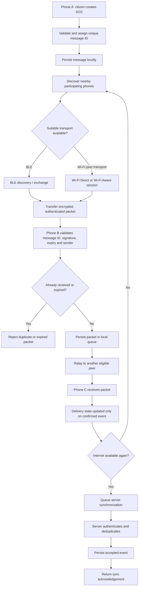
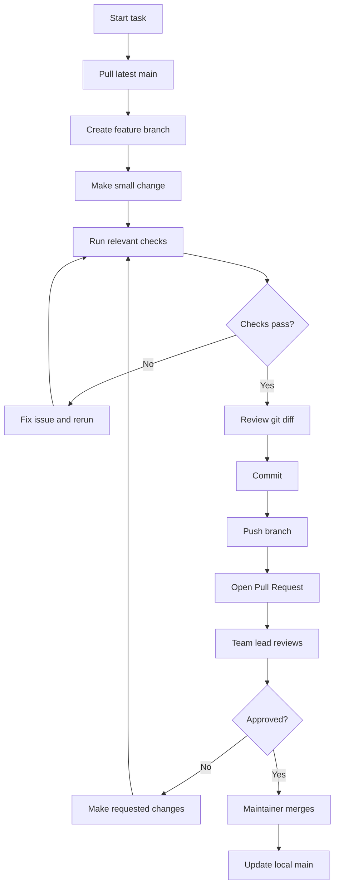

# CityFix — Team Setup & Contributor Guide

> **Read this document from top to bottom. Do not skip steps.**
>
> This guide is written for contributors who have never set up a software project before. Follow the steps in order, copy commands exactly, and stop when a step fails. Do not randomly change versions or install extra packages to “fix” an error.

**Repository:** https://github.com/souravsviswajith/cityfix  
**Default branch:** `main`  
**Primary product:** Native Android application  
**Additional project surface:** React/TypeScript browser prototype and Express API  
**Current Android application ID:** `com.cityfix.android`  
**Current Android minimum SDK:** 26  
**Current Android compile/target SDK:** 35  
**Current Android toolchain:** JDK 17, Android Gradle Plugin 8.7.3, Gradle 8.9, Kotlin 2.0.21

---

## 0. First understand what you are setting up

CityFix is an Android-only civic reporting and disaster-awareness project.

A citizen should be able to record a civic issue, attach location and evidence with permission, prepare a complaint, and understand which authority may be responsible. The disaster-management module is intended to support local incident coordination when connectivity is poor.

### Important product boundaries

Do not tell judges, users, or teammates that a feature works just because a screen exists.

| Area | Current state in this repository |
|---|---|
| Native Android app | Initial Kotlin + Jetpack Compose foundation |
| SOS capture | Creates an incident and saves it locally using Room |
| Device location | Uses a recent cached location when available; it does not guarantee a fresh GPS fix |
| BLE | Checks device capability/adapter state; does not yet implement peer discovery or message relay |
| Wi-Fi Direct / Wi-Fi Aware | Not implemented as a complete peer transport |
| CEMN multi-hop mesh | Architecture and requirements documented; end-to-end relay is not yet implemented |
| React browser interface | Existing browser prototype/reference |
| Google Maps | Browser prototype integration exists; do not assume a native Android Google Map screen exists |
| Authority directory / jurisdiction | API deliberately reports unavailable until authoritative data and GIS boundaries are configured |
| Government complaint delivery | No verified government-system submission/acknowledgement integration |
| Backend | Express API exists; database-backed operations require separately configured PostgreSQL and Firebase Admin credentials |
| Gemini | Server-side draft endpoint exists, but requires a valid server-side API key and supported model configuration |

**Never claim that CityFix dispatches emergency services.** A locally saved SOS is not a broadcast. A relayed message is not proof of receipt. Receipt is not acknowledgement. Acknowledgement is not official dispatch.

If someone is in immediate danger, they must contact the appropriate emergency service directly.

---

# Part A — One-time computer setup

## 1. Computer requirements

For the easiest setup, use a Windows 10/11 64-bit computer.

Recommended:
- 16 GB RAM or more.
- At least 30 GB free disk space.
- Stable internet connection.
- Administrator access for installing developer tools.
- Android phone with USB cable if you will test on a real device.

A computer with 8 GB RAM may run the tools, but Android Studio plus an emulator can be slow. If the emulator is too slow, use a physical Android phone.

## 2. Install Git

Git is the tool used to download the project and share code changes.

1. Open this page: https://git-scm.com/download/win
2. Download Git for Windows.
3. Run the installer.
4. Keep the recommended default options.
5. Complete installation.
6. Press the Windows key.
7. Type `PowerShell`.
8. Open **Windows PowerShell**.
9. Run:

```powershell
git --version
```

Expected result: a version number such as `git version 2.x.x`.

If PowerShell says that `git` is not recognized, close PowerShell, open it again, and retry. If it still fails, reinstall Git and ensure the installer option that adds Git to PATH is enabled.

## 3. Install Node.js 22

Node.js is required for the React/TypeScript browser prototype and Express API.

1. Open: https://nodejs.org/en/download
2. Download the **Node.js 22 LTS** Windows installer.
3. Run the installer.
4. Keep the default options, including the option to add Node.js to PATH.
5. Finish the installation.
6. Close PowerShell and open it again.
7. Run:

```powershell
node --version
npm --version
```

Expected:
- Node reports version 22.x.
- npm reports a version number.

If Node reports a version other than 22, install the 22 LTS release before continuing. Do not install multiple Node versions unless you know how to manage them.

## 4. Install Android Studio

Android Studio is the official IDE used to open, build, and run the native Android app.

1. Open: https://developer.android.com/studio
2. Download Android Studio for Windows.
3. Run the installer.
4. Keep these components selected:
   - Android Studio
   - Android SDK
   - Android SDK Platform
   - Android Virtual Device
5. Complete installation.
6. Open Android Studio.
7. If the setup wizard appears, choose **Standard** setup.
8. Accept the Android SDK licenses.
9. Wait for the SDK downloads to finish.

Do not close Android Studio while it is downloading the SDK.

## 5. Install Android SDK Platform 35 and Build Tools 35.0.0

The project currently compiles against Android API 35.

1. Open Android Studio.
2. On the welcome screen, choose **More Actions → SDK Manager**. If a project is already open, use **Tools → SDK Manager**.
3. Open the **SDK Platforms** tab.
4. Tick **Android 15.0 (Vanilla Ice Cream) / API Level 35**.
5. Open the **SDK Tools** tab.
6. Tick **Android SDK Build-Tools** and ensure version **35.0.0** is installed.
7. Ensure **Android SDK Platform-Tools** is installed.
8. Ensure **Android SDK Command-line Tools (latest)** is installed.
9. Click **Apply**.
10. Accept licenses and wait for installation to finish.

The Android project uses:
- `compileSdk = 35`
- `targetSdk = 35`
- `minSdk = 26`

Do not change these values just because a newer SDK is available.

## 6. Confirm the Java version (JDK 17)

The Android project is configured for Java 17.

Android Studio includes a bundled runtime, but the command-line build must also use JDK 17.

1. Open Android Studio.
2. Open **File → Settings → Build, Execution, Deployment → Build Tools → Gradle**.
3. Find **Gradle JDK**.
4. Select an installed **JDK 17**. Android Studio's bundled JDK may be newer; do not assume it is 17.
5. If JDK 17 is not available, install a Temurin JDK 17 build from https://adoptium.net/temurin/releases/?version=17
6. Restart Android Studio after installation.
7. In PowerShell, run:

```powershell
java -version
```

Expected output must identify Java 17.

If PowerShell reports another version, Android Studio may still use the correct Gradle JDK, but the command-line build will not. Configure `JAVA_HOME` to the JDK 17 installation and reopen PowerShell.

Example only — replace the path with the actual folder on your computer:

```powershell
$env:JAVA_HOME = "C:\Program Files\Eclipse Adoptium\jdk-17"
$env:Path = "$env:JAVA_HOME\bin;$env:Path"
java -version
```

Do not paste an example path blindly. The folder name depends on the JDK installer version.

## 7. Install Gradle 8.9 for command-line Android builds

**Important:** this repository currently does not contain the Gradle Wrapper files (`gradlew`, `gradlew.bat`, and `gradle/wrapper/`). Therefore, the command `.gradlew` will not work from this checkout.

The Android CI currently installs Gradle 8.9 explicitly. To match it locally:

1. Open: https://gradle.org/releases/
2. Download the **Gradle 8.9 binary-only ZIP**.
3. Extract it to a stable folder, for example `C:\DevTools\gradle-8.9`.
4. The executable should be at `C:\DevTools\gradle-8.9\bin\gradle.bat`.
5. Add that `bin` folder to your Windows PATH, or use the temporary PowerShell command below.

Temporary setup for the current PowerShell window:

```powershell
$env:GRADLE_HOME = "C:\DevTools\gradle-8.9"
$env:Path = "$env:GRADLE_HOME\bin;$env:Path"
gradle --version
```

Expected: Gradle 8.9 and JVM 17.

If the Gradle version or JVM is different, stop and fix that before building Android.

---

# Part B — Download the CityFix project

## 8. Create a workspace folder

1. Open File Explorer.
2. Open your D: drive if available. Otherwise use C:.
3. Create a folder named `Workspace`.
4. Open that folder.
5. Click the address bar, type `powershell`, and press Enter.

You should now have a PowerShell window whose current directory is your workspace folder.

Alternatively, run:

```powershell
New-Item -ItemType Directory -Force D:\Workspace
Set-Location D:\Workspace
```

If you do not have a D: drive, use a folder under your Windows user directory instead.

## 9. Clone the repository

Copy and run this exact command:

```powershell
git clone https://github.com/souravsviswajith/cityfix.git
```

Wait until Git finishes downloading.

Enter the project folder:

```powershell
Set-Location .\cityfix
```

Confirm that you are in the correct folder:

```powershell
Get-Location
Get-ChildItem
```

You should see project files such as:
- `README.md`
- `package.json`
- `bun.lock`
- `server.ts`
- `src`
- `android`
- `.github`

If you do not see these files, you are in the wrong folder. Do not continue until you are inside the repository root.

## 10. Check the Git branch

Run:

```powershell
git status
git branch --show-current
```

The initial branch should be `main`.

Before doing any work, get the latest shared changes:

```powershell
git switch main
git pull origin main
```

If Git reports that you have local changes, do not run a reset or delete files. Ask the team lead before proceeding.

---

# Part C — Run the native Android application

## 11. Open the correct Android project

There are two folders in this repository:
- Repository root: browser prototype and API.
- `android/`: native Android application.

For the Android app, open the **android folder**, not the repository root.

1. Start Android Studio.
2. On the welcome screen, choose **Open**.
3. Navigate to the cloned project folder.
4. Select the `android` folder.
5. Click **OK / Open**.
6. If Android Studio asks whether you trust the project, confirm only because you cloned it from the team's known repository.
7. Wait for project indexing and Gradle sync to complete.

The project name should appear as `CityFixAndroid`.

## 12. Wait for Gradle sync

The first sync can take several minutes because Gradle must download plugins and Android dependencies.

Do not:
- Close Android Studio during sync.
- Change plugin versions.
- Delete Gradle caches.
- Download random JAR files from websites.
- Copy another person's `.gradle` folder.

If the sync fails:
1. Open the **Build** or **Sync** output panel.
2. Find the first line containing `What went wrong`.
3. Copy the complete error from that point to the end.
4. Send the error to the team lead.
5. Do not guess at a fix.

### Known build issue observed in CI

On 22 November 2026, the Android CI job for commit `3c66ceb6` failed while resolving:

```text
com.google.devtools.ksp
version 2.0.21-1.0.28
```

The web/API validation job passed, but Android assembly failed because Gradle could not resolve that plugin from the configured plugin repositories. This is a known repository/toolchain blocker, not proof that your computer is configured incorrectly.

If you see the same KSP plugin resolution error:
- Confirm you have internet access.
- Confirm Android Studio is not behind a proxy that blocks Google Maven, Maven Central, or the Gradle Plugin Portal.
- Retry Gradle sync once.
- If it still fails, stop and report the error. Do not randomly upgrade Kotlin, KSP, AGP, or Gradle versions. Those versions must be changed together and tested by the maintainer.

## 13. Create an Android emulator

An emulator is a virtual Android phone running on your computer.

1. In Android Studio, open **Tools → Device Manager**.
2. Click **Create Device**.
3. Choose a common phone profile, such as **Pixel 6**.
4. Click **Next**.
5. Choose a system image for API 35.
6. If the image is not installed, click **Download**.
7. Accept the license.
8. Wait for the download to finish.
9. Select the image.
10. Click **Next → Finish**.
11. In Device Manager, click the ▶ button next to the new virtual device.
12. Wait for Android to finish booting.

If the emulator is extremely slow:
- Close other heavy applications.
- Check that hardware virtualization is enabled in BIOS/UEFI.
- Use a physical Android phone instead.
- Do not create several emulators at once.

## 14. Run CityFix on the emulator

1. Make sure the emulator is fully booted.
2. Return to Android Studio.
3. In the top toolbar, select the `app` run configuration.
4. Select the running emulator as the target device.
5. Click the green ▶ **Run** button.
6. Wait for Gradle to build and install the app.
7. The CityFix application should open on the emulator.

If Android Studio says there is no run configuration:
- Open the `android` folder as described in Step 11.
- Wait for Gradle sync.
- Check that `app` is included in `android/settings.gradle.kts`.

## 15. Run on a real Android phone

A real phone is required for meaningful Bluetooth and nearby-device testing. An emulator is not a substitute for physical BLE testing.

1. On the phone, open **Settings → About phone**.
2. Find **Build number**.
3. Tap **Build number** seven times. Enter the phone PIN if requested.
4. Go back to Settings.
5. Open **Developer options**.
6. Enable **USB debugging**.
7. Connect the phone to the computer using a data-capable USB cable.
8. Unlock the phone.
9. Accept the **Allow USB debugging?** prompt.
10. In Android Studio, select the phone from the device list.
11. Click **Run ▶**.

To check that the phone is visible, open PowerShell and run:

```powershell
adb devices
```

The phone should appear with the state `device`. If it says `unauthorized`, unlock the phone and accept the USB debugging prompt.

When finished testing, disable USB debugging if you do not need it.

## 16. Understand what you should see in the Android app

The current native app contains:
- CityFix title and Disaster Management screen.
- Emergency SOS section.
- Create SOS action.
- Incident category selection.
- Description field.
- Device capability information.
- Location and nearby-device permission request.
- Local incident history.

### Test a local SOS

1. Open the app.
2. Tap **Grant location and nearby-device permissions**.
3. Grant only the permissions needed for the test.
4. Tap **Create SOS**.
5. Select an incident category.
6. Enter a short test description, such as `TEST ONLY — blocked road near demo location`.
7. Tap **Save SOS locally**.
8. Confirm that the incident appears under Incident history.
9. Close the app.
10. Open it again.
11. Confirm that the incident remains visible.

This proves local persistence on that device. It does **not** prove that the SOS was sent to another phone or an emergency agency.

Use synthetic test data. Do not enter a real person's phone number, address, medical information, or emergency details into a demo incident.

---

# Part D — Optional browser prototype and API

The browser interface is a separate project surface. It is useful for understanding and testing the existing browser prototype, but it is not the native Android application.

## 17. Install browser/API dependencies

Open a new PowerShell window, or return to the repository root:

```powershell
Set-Location D:\Workspace\cityfix
```

Confirm that `package.json` is present:

```powershell
Test-Path .\package.json
```

Expected output: `True`.

Install dependencies:

```powershell
npm install
```

Wait until npm finishes. Do not close the terminal while it is installing.

The repository currently commits a `bun.lock` file, while the CI workflow uses `npm install`. The command above follows the current CI workflow, but it may create a local `package-lock.json`. Do not commit a newly generated lockfile unless the maintainer has decided that npm will become the repository's canonical package manager.

If npm reports a dependency conflict, do not use `--force` or `--legacy-peer-deps` without approval. Send the complete error to the maintainer.

## 18. Create the local environment file

The repository includes `.env.example`. It is a template, not a file containing working credentials.

From the repository root:

```powershell
Copy-Item .env.example .env
```

Open `.env` using VS Code or Notepad.

The example currently contains:

```dotenv
GEMINI_API_KEY=
VITE_GOOGLE_MAPS_API_KEY=
PORT=3000
```

Meaning:
- `GEMINI_API_KEY`: optional server-side Gemini API key. Keep it private.
- `VITE_GOOGLE_MAPS_API_KEY`: browser Google Maps key. It is delivered to the browser and must be restricted in Google Cloud by allowed APIs and website referrers.
- `PORT`: documented example setting; the current server source uses port 3000 directly, so do not assume changing this variable changes the listening port.

### Secret handling rules

- Never paste API keys into GitHub issues, commits, screenshots, chat messages, or source files.
- Never commit `.env`.
- Never put a Gemini key in a variable beginning with `VITE_`.
- A browser Maps key is not a server secret, but it must still have API and referrer restrictions.
- Do not share Firebase Admin credentials or service-account JSON files.
- If a secret is accidentally committed, tell the maintainer immediately. Deleting the line in a later commit does not revoke the exposed secret; it must be rotated.

## 19. Start the browser prototype/API

From the repository root:

```powershell
npm run dev
```

Keep this terminal open. It is running the development server.

Open a browser and visit:

- http://localhost:3000

To check the basic health endpoint, open:

- http://localhost:3000/api/health

Expected response is JSON containing `ok: true`, service name, and a timestamp.

To stop the server, return to the terminal and press:

```text
Ctrl + C
```

### Backend configuration warning

The server source also expects PostgreSQL settings for database-backed operations:

```dotenv
SQL_HOST=
SQL_USER=
SQL_PASSWORD=
SQL_DB_NAME=
```

These are not currently included in `.env.example`. Do not invent values. Ask the maintainer for an approved development database or a local database setup plan.

The server's Firebase Admin authentication path also requires valid server-side Google Application Default Credentials or another approved Firebase Admin credential setup. A public Firebase web configuration file is not an Admin credential.

Without those services, the browser development server may start and health check may work, while authenticated/database-backed API operations fail. This is expected until the backend dependencies are configured.

Authority directory and jurisdiction routes currently return an unavailable response until verified government data and GIS boundaries are configured. Do not treat that response as a local setup error.

---

# Part E — Architecture explained

## 20. High-level system architecture

The native Android app is the primary citizen product. The browser prototype is a separate development surface. The backend is a modular monolith, not a collection of microservices.



### What each component does

| Component | Responsibility |
|---|---|
| Android app | Citizen-facing native mobile application |
| Jetpack Compose | Builds Android screens |
| Room | Stores incident records on the device |
| Location provider | Reads device location after permission is granted |
| BLE | Nearby device capability and future discovery/transport |
| Wi-Fi Direct/Aware | Planned peer communication transport |
| React + TypeScript | Browser prototype/reference interface |
| Express | HTTP API and WebSocket server |
| Firebase Authentication | User identity/authentication provider |
| Firebase Admin | Server-side verification of Firebase identity tokens |
| PostgreSQL | Durable server-side report and coordination data |
| Gemini | Optional server-side AI-assisted drafting |
| Official data + GIS | Future verified authority/jurisdiction data source |

## 21. Current Android data flow



**Important:** This is a local persistence workflow. It does not include a network send or peer relay.

## 22. Intended CEMN offline relay workflow

This is the target workflow, not a claim that it is already implemented.



### Required CEMN concepts

- Unique message IDs.
- Message expiry / time-to-live (TTL).
- Duplicate suppression.
- Local durable queue.
- Sender authentication.
- Packet integrity checks and cryptographic signatures.
- Encryption for sensitive data.
- Explicit delivery acknowledgements.
- Retry/backoff and synchronization after connectivity returns.
- Android permission and battery/background limitations.

BLE and Wi-Fi APIs are transports. They do not automatically implement routing, store-and-forward, deduplication, trust, or acknowledgement.

### Delivery-state meanings

| State | Meaning |
|---|---|
| Queued | Saved locally and waiting for a delivery attempt |
| Relayed | Another participating device forwarded the packet |
| Received | A destination device confirmed packet receipt |
| Acknowledged | An authorized recipient explicitly acknowledged it |
| Response in progress | An authorized responder recorded that work has started |
| Resolved | An authorized workflow recorded resolution with supporting evidence |

Never show **Relayed** as **Acknowledged**. Never show **Acknowledged** as **Dispatched**.

---

# Part F — Development workflow for every teammate

## 23. Before starting work

Every time you start working:

1. Open PowerShell.
2. Go to the repository:

```powershell
Set-Location D:\Workspace\cityfix
```

3. Check your current branch:

```powershell
git branch --show-current
```

4. Check for uncommitted work:

```powershell
git status
```

5. Update the main branch:

```powershell
git switch main
git pull origin main
```

6. Create a separate branch for your task. Replace `your-name` and `short-task-name`:

```powershell
git switch -c feature/your-name-short-task-name
```

Example:

```powershell
git switch -c feature/riya-sos-screen-copy
```

Do not work directly on `main`.

## 24. Make one small change at a time

Good examples:
- Fix one button label.
- Improve one screen.
- Add one validation check.
- Fix one layout issue.
- Add one unit test.

Bad examples:
- Rewrite the entire app.
- Upgrade every dependency.
- Rename multiple folders without approval.
- Change authentication and database logic at the same time.
- Copy code from an unknown website and commit it without understanding the license.

After making a change:
1. Save the file.
2. Run the relevant build/check.
3. Open the app and test the change.
4. Review the changed files.
5. Commit only the files related to your task.

## 25. Run checks before committing

### Browser/API checks

From repository root:

```powershell
npm run check
```

This runs TypeScript type checking and the Vite production build.

Expected: command completes without errors.

### Android build

From repository root:

```powershell
Set-Location .\android
gradle :app:assembleDebug
Set-Location ..
```

Expected output includes:

```text
BUILD SUCCESSFUL
```

If the known KSP plugin resolution issue occurs, capture the error and report it. Do not mark Android as tested if the build did not complete.

## 26. Review exactly what you changed

Run:

```powershell
git status
git diff --check
git diff
```

Check:
- Did you modify only files related to your task?
- Did you accidentally add `.env`, API keys, passwords, screenshots with personal information, or generated build files?
- Did you change dependency versions without approval?
- Does the diff contain unrelated formatting changes?

If you see something you do not understand, ask before committing.

## 27. Commit your work

Stage only the intended files. Example:

```powershell
git add path/to/file
```

If you changed more than one intended file, add each path explicitly.

Create a clear commit:

```powershell
git commit -m "feat(android): improve SOS incident form"
```

Suggested commit prefixes:
- `feat:` new feature
- `fix:` bug fix
- `docs:` documentation
- `test:` tests
- `refactor:` internal restructuring
- `chore:` maintenance

## 28. Push your branch

```powershell
git push -u origin HEAD
```

Wait for Git to finish. If GitHub asks you to authenticate, use the official browser login flow.

## 29. Open a Pull Request

1. Open https://github.com/souravsviswajith/cityfix
2. GitHub may show a banner saying your branch was recently pushed.
3. Click **Compare & pull request**.
4. Confirm:
   - Base repository: `souravsviswajith/cityfix`
   - Base branch: `main`
   - Compare branch: your feature branch
5. Enter a short title.
6. In the description, explain:
   - What you changed.
   - Why you changed it.
   - How you tested it.
   - What did not work or remains incomplete.
7. Click **Create pull request**.
8. Send the PR link to the team lead.
9. Wait for review. Do not merge your own PR unless the maintainer explicitly tells you to.

### Pull request workflow



## 30. After your Pull Request is merged

Update your local main branch:

```powershell
git switch main
git pull origin main
```

Delete your local feature branch only after the PR is merged:

```powershell
git branch -d feature/your-name-short-task-name
```

If Git says the branch is not fully merged, stop and ask the maintainer. Do not force-delete it.

---

# Part G — Who works on what?

## 31. Suggested beginner-friendly team roles

Assign one owner to each work area. A person can help another area, but every task must have one clearly responsible owner.

| Role | Responsibilities | Do not change without maintainer approval |
|---|---|---|
| Android UI contributor | Compose screens, labels, spacing, accessibility, UI states | Gradle, auth, database schema |
| Android incident contributor | SOS form validation, incident display, local persistence tests | Encryption, responder authorization |
| Browser UI contributor | React components and browser prototype styling | Server authentication, API authorization |
| QA / tester | Follow test cases, record bugs, collect sanitized logs | Source code unless assigned |
| Documentation / research | Setup docs, screenshots with synthetic data, source references | Security policy or official claims |
| Integration lead / maintainer | Architecture, dependencies, API, database, secrets, review, releases | Must review high-risk changes |

## 32. How to report a bug

Do not send a message saying only “it is not working”.

Use this template:

```text
BUG TITLE:
[Short description]

DEVICE:
[Windows version / Android phone model]

BRANCH:
[Branch name]

WHAT I DID:
1.
2.
3.

WHAT I EXPECTED:
[What should have happened]

WHAT ACTUALLY HAPPENED:
[What happened instead]

ERROR MESSAGE:
[Paste the complete error]

SCREENSHOT:
[Attach only if it contains no personal information or secrets]

CAN I REPEAT IT?
[Always / Sometimes / Only once]
```

For Android Studio build failures, include:
- The first `What went wrong` block.
- The plugin or dependency name.
- Gradle version.
- Java version.
- Whether the failure occurs on sync or assemble.

Never send API keys, passwords, Firebase service-account files, private citizen data, or unredacted location details in a bug report.

---

# Part H — Testing checklist

## 33. Basic Android test

- [ ] App opens on emulator or physical device.
- [ ] SOS form opens.
- [ ] Category can be selected.
- [ ] Description can be entered.
- [ ] Empty description behavior is checked.
- [ ] SOS can be saved locally.
- [ ] Saved SOS appears in incident history.
- [ ] Saved SOS remains after app restart.
- [ ] Location denied case is tested.
- [ ] Location granted case is tested.
- [ ] No false claim of network delivery appears.

## 34. Browser/API test

- [ ] Dependencies install.
- [ ] `npm run check` completes.
- [ ] `npm run dev` starts.
- [ ] Browser opens at `http://localhost:3000`.
- [ ] `/api/health` returns `ok: true`.
- [ ] Missing optional API keys do not get committed.
- [ ] Database-backed routes are tested only with an approved database.
- [ ] Unavailable authority/jurisdiction data is displayed as unavailable, not fabricated.

## 35. CEMN test plan — only after relay implementation exists

This test is not currently possible end-to-end with the current Android foundation. It is the acceptance scenario for the future implementation.

- [ ] Three physical Android phones are available.
- [ ] Phone A creates an SOS.
- [ ] Phone B receives the packet from A.
- [ ] Phone C receives the packet through B.
- [ ] Internet is disabled on all phones during the local relay.
- [ ] Duplicate packets are suppressed.
- [ ] Expired packets are rejected.
- [ ] Unauthorized packets cannot create official alerts or evacuation orders.
- [ ] Delivery state matches actual acknowledgement events.
- [ ] Internet is restored.
- [ ] Queued events synchronize.
- [ ] Server deduplicates replayed events.
- [ ] No duplicate incidents are created.

---

# Part I — Troubleshooting

## 36. `git` is not recognized

Cause: Git is not installed or is not on PATH.

Fix:
1. Install Git for Windows.
2. Close PowerShell.
3. Open PowerShell again.
4. Run `git --version`.

## 37. `node` or `npm` is not recognized

Cause: Node.js is not installed or the terminal was not restarted.

Fix:
1. Install Node.js 22 LTS.
2. Close PowerShell.
3. Reopen PowerShell.
4. Run `node --version` and `npm --version`.

## 38. Android Studio cannot find SDK 35

Cause: Android SDK Platform 35 is not installed.

Fix:
1. Open SDK Manager.
2. Install Android API 35.
3. Install Build Tools 35.0.0.
4. Sync the project again.

## 39. Android Studio says Java version is unsupported

Cause: Gradle is using the wrong JDK.

Fix:
1. Open Android Studio Gradle settings.
2. Set Gradle JDK to JDK 17.
3. Check `java -version` in PowerShell.
4. Restart Android Studio.
5. Retry sync.

## 40. Gradle cannot resolve KSP

Cause: The current repository's KSP plugin dependency failed to resolve in CI on 22 November 2026.

Fix:
1. Check internet connection.
2. Retry sync once.
3. Check whether proxy/firewall settings block Google Maven, Maven Central, or Gradle Plugin Portal.
4. Capture the complete error.
5. Send it to the maintainer.

Do not change KSP/Kotlin/Gradle versions independently.

## 41. `gradlew` or `gradlew.bat` is missing

Cause: The repository currently has no committed Gradle Wrapper.

Fix:
- Use the installed Gradle 8.9 command: `gradle :app:assembleDebug`.
- Do not run `./gradlew` or `gradlew.bat` until the maintainer adds the wrapper files.

## 42. Browser server starts but database routes fail

Cause: PostgreSQL and/or Firebase Admin credentials are not configured.

Fix:
- Confirm whether the team has an approved development database.
- Ask the maintainer for the correct local environment variable names and secure credential delivery method.
- Do not invent database hostnames or use production credentials.
- Do not commit credentials.

## 43. Google Maps does not load in browser

Possible causes:
- No browser Maps API key is configured.
- The key is restricted to a different website origin.
- The required Maps JavaScript API is not enabled.
- Billing or API restrictions prevent requests.

Fix:
1. Ask the maintainer whether a development Maps key is available.
2. Confirm the key has website referrer restrictions.
3. Confirm the required API is enabled in Google Cloud.
4. Do not copy a private key from another developer.

Remember: the existing Google Maps integration is in the browser prototype. The native Android app does not automatically inherit it.

## 44. Phone does not appear in Android Studio

Fix:
1. Unlock the phone.
2. Confirm USB debugging is enabled.
3. Use a data-capable USB cable.
4. Accept the RSA authorization prompt on the phone.
5. Run `adb devices`.
6. If still missing, try another USB port or install the device manufacturer's USB driver.

## 45. App says location unavailable

Possible causes:
- Permission denied.
- Device location services are off.
- No recent cached location is available.
- Emulator location is not configured.

Fix:
1. Enable device Location.
2. Grant CityFix location permission.
3. For emulator, open Extended Controls and set a test location.
4. Retry.

The current implementation reads a recent cached location fix when available. It does not promise a fresh GPS fix.

---

# Part J — Rules that every contributor must follow

## 46. Never do these things

1. Never push directly to `main`.
2. Never commit `.env`, API keys, passwords, tokens, or service-account JSON.
3. Never use real citizen personal data in screenshots or demos.
4. Never invent government officials, departments, phone numbers, or jurisdiction boundaries.
5. Never label synthetic data as live data.
6. Never claim that a report was officially submitted unless a real integration confirms it.
7. Never claim that an SOS was delivered merely because it was saved locally.
8. Never claim that BLE mesh relay works until the three-device acceptance test passes.
9. Never assign yourself responder or coordinator privileges.
10. Never change dependency versions to silence an error without maintainer review.
11. Never force-push or rewrite shared branches.
12. Never merge a Pull Request without the required review.

## 47. Definition of done

A task is done only when all applicable statements are true:

- [ ] The change matches the assigned task.
- [ ] The code is saved in the correct feature branch.
- [ ] No secrets or personal data were added.
- [ ] Relevant build/check commands were run.
- [ ] The changed behavior was tested.
- [ ] The Git diff was reviewed.
- [ ] The commit message describes the change.
- [ ] The branch was pushed.
- [ ] A Pull Request was opened.
- [ ] The Pull Request explains testing and known limitations.
- [ ] The maintainer reviewed and approved the change.

**If you are stuck:** stop, capture the exact error, and ask the team lead. Do not randomly edit files until the error disappears.

---

## Quick command reference

Run these commands from PowerShell.

### Download/update project

```powershell
git clone https://github.com/souravsviswajith/cityfix.git
Set-Location .\cityfix
git switch main
git pull origin main
```

### Browser prototype

```powershell
npm install
Copy-Item .env.example .env
npm run dev
```

Open http://localhost:3000

### Browser/API validation

```powershell
npm run check
```

### Android build

```powershell
Set-Location .\android
gradle :app:assembleDebug
Set-Location ..
```

### Start a task

```powershell
git switch main
git pull origin main
git switch -c feature/your-name-short-task-name
```

### Save and publish work

```powershell
git status
git diff --check
git add path/to/your-file
git commit -m "fix: describe your change"
git push -u origin HEAD
```

Then open a Pull Request on GitHub.

---

**Document maintenance:** This guide reflects the repository configuration inspected on 22 November 2026. If Gradle, Android SDK, Node.js, repository scripts, or environment variables change, the maintainer must update this guide. Do not silently follow outdated instructions after the project configuration changes.


---

# Part G — Build artifacts and release distribution

## 25. Understand the two GitHub download options

CityFix may use two different GitHub distribution paths. They are not interchangeable.

### CI workflow artifact (development / QA)

A CI artifact is attached to a GitHub Actions workflow run. If the workflow uploads an APK, open the repository's **Actions** tab, select the successful Android build run, and download the artifact from its Artifacts section. This is suitable for testing a particular commit. It may expire according to repository retention settings and is not a public versioned release.

The current Android workflows assemble a debug APK. A debug APK is for development and testing only. Do not distribute it as a production build.

### GitHub Release asset (versioned distribution)

A GitHub Release is a versioned distribution record associated with a Git tag. When CityFix has a validated release workflow, download the APK from the repository's **Releases** page. Check the release notes, version, source tag, signing status, supported Android versions, and SHA-256 checksum before installing it.

A production-facing release must use a release build variant and protected signing credentials. Never ask a teammate to send you a keystore or signing password over chat. Signing material must remain in an approved protected environment.

### Current status

The repository documents CI-artifact and GitHub-Release distribution as options. A verified production signing configuration and a dedicated GitHub Release upload workflow are not yet established. Do not expect a production APK in Releases. Follow the README's [Build artifacts and release options](../README.md#build-artifacts-and-release-options) section for the current release status.

