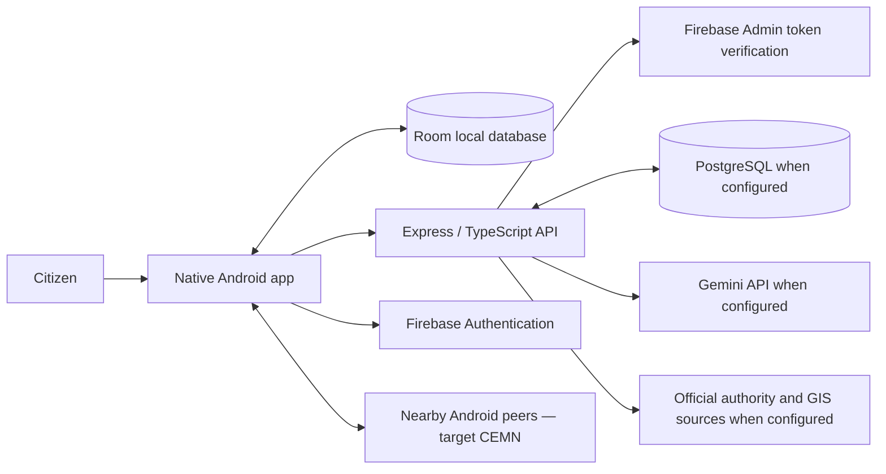

# CityFix — Architecture Overview

This document is a concise architecture companion to the [canonical System Architecture](../ARCHITECTURE.md). If a detail differs, update both in the same change and use the canonical architecture as the detailed reference.

## 1. Product scope

CityFix is an Android-only citizen-to-government civic reporting and disaster-management platform. It helps citizens document local problems, attach geographic context, discover potentially responsible authorities from attributable sources, verify identity/role/jurisdiction/contact records, and prepare citizen-reviewed complaints.

A separate Disaster Management module supports structured incident reporting, emergency information, and a target offline coordination capability.

The native Android application is the product client. The React/TypeScript browser interface is a prototype/reference surface, not a supported web or mobile client.

**Product boundary:** CityFix supports reporting, information discovery, preparedness, and coordination. It does not dispatch emergency services or guarantee government action. Official submission, acknowledgement, dispatch, and resolution may only be claimed when a real integration confirms them.

## 2. Architectural principles

1. **Android-only product:** Kotlin + Jetpack Compose is the primary client.
2. **Modular-monolith backend:** the current server is Express/TypeScript; keep domain boundaries within a single backend deployable unless operational evidence justifies another topology.
3. **Offline-first capture:** incident capture and local persistence must not depend on backend availability.
4. **Authority provenance:** identity, jurisdiction, designation, responsibility, and contacts require attributable sources, timestamps, and verification status.
5. **Human review:** citizens review and edit generated complaint drafts before sharing.
6. **Explicit state:** local save, queued, relayed, received, acknowledged, response-in-progress, and resolved are distinct states.
7. **Fail closed:** missing identity, authority, jurisdiction, or provider evidence must result in unavailable/partial states, not fabricated data or privilege.
8. **Privacy by default:** minimize personal data and limit precise location and evidence access to authorized purposes.

## 3. System context



This is a logical context view, not a claim that every edge is currently configured or operational. See the status table below and the [security baseline](../security/implementation-baseline.md).

## 4. Current implementation status

| Component | Status | Verified boundary |
|---|---|---|
| Native Android shell | Implemented foundation | Kotlin + Compose application exists |
| SOS capture | Implemented foundation | Incident can be saved locally using Room |
| Location | Partial | A recent cached fix may be used; a fresh GPS fix is not guaranteed |
| BLE | Partial | Device capability/adapter checks; no complete peer discovery or relay |
| Wi-Fi Direct / Wi-Fi Aware | Not implemented as complete transports | No complete peer transport workflow |
| CEMN multi-hop relay | Planned / not verified | No demonstrated end-to-end three-device relay |
| Browser UI | Prototype/reference | React/TypeScript surface, separate from native Android |
| Browser Google Maps | Prototype integration | Does not imply a native Android map screen |
| Express API | Present; configuration-dependent | Server exists; production readiness and complete provider-backed operations are not established |
| Firebase identity | Configuration-dependent | Client/server integration requires valid deployment configuration and authorization review |
| PostgreSQL | Configuration-dependent | Required for configured durable server-side operations |
| Gemini drafting | Configuration-dependent | Server-side key/model configuration required; output remains a draft |
| Authority / jurisdiction | Unavailable until verified sources are configured | Do not invent officials, departments, contacts, or boundaries |
| Government submission | Not implemented/verified | No claim of official registration or acknowledgement |
| Emergency dispatch | Not implemented | CityFix is not an emergency dispatch service |

## 5. Application boundaries

### Android client

Responsibilities:
- Citizen-facing civic reporting and disaster-management screens.
- Permission requests and local device capability inspection.
- Incident capture and Room persistence.
- Future peer discovery and transport orchestration.
- Truthful connectivity and delivery-state presentation.

The Android client must not decide that a user is an official responder based on client-side claims, email strings, or locally editable fields.

### Backend

The current server is Express/TypeScript. The intended deployment shape is a modular monolith, with logical boundaries such as:
- Authentication and identity.
- Civic reports and access control.
- Authority and jurisdiction source adapters.
- AI-assisted complaint drafting.
- Disaster incidents and optional CEMN synchronization.
- Audit and operational telemetry.

These are logical boundaries, not a claim that every module is complete or independently deployable. PostgreSQL and Firebase-backed operations depend on valid configuration and security controls.

### AI boundary

Gemini may assist with classification, translation, summarization, and complaint-draft generation. It must not:
- Establish a person's official identity or responder authorization.
- Invent jurisdiction, official contacts, or source evidence.
- Decide dispatch, official acknowledgement, or resolution.
- Issue authoritative evacuation instructions.

AI-generated content remains draft content for human review.

## 6. Security boundaries

- Verify Firebase identity tokens server-side where Firebase authentication is used.
- Base authorization on trusted server-side role/permission records, not email allowlists or client-supplied role values.
- Scope citizen access to reports according to the server authorization policy.
- Protect precise coordinates, media, and contact details with least-privilege access.
- Validate CEMN events before they can change trusted state; the full cryptographic peer protocol is not yet demonstrated.
- Keep API keys and service credentials outside source control and client bundles.
- Track actual controls and known gaps in the [security implementation baseline](../security/implementation-baseline.md).

## 7. Design target: Android feature organization

The following is a logical target, not a description of the current Gradle module layout:

```text
:app
:core
  :database
  :location
  :network
  :security
  :mesh
    :discovery
    :transport
    :routing
    :message-queue
    :synchronization
:feature
  :report
    :evidence
    :geotagging
    :authority-discovery
    :authority-verification
    :complaint
  :disaster
    :incident
    :sos
    :offline-map
    :rescue-coordination
```

Current implementation is a single Android application module with internal package boundaries. Split Gradle modules only when ownership, build isolation, or dependency constraints justify the additional complexity.

## 8. Key architecture decisions

| Decision | Rationale |
|---|---|
| Native Android is the only product client | Matches the product scope |
| Express/TypeScript backend, modular-monolith organization | Matches the current server while keeping deployment simple |
| Room stores local incidents | Supports capture when backend connectivity is absent |
| BLE/Wi-Fi are transports, not mesh logic | Routing, TTL, deduplication, authentication, and acknowledgements belong to the application protocol |
| Official data requires provenance | Prevents false authority and jurisdiction claims |
| AI output is advisory | Preserves citizen and authorized-human decision authority |
| Explicit delivery states | Prevents local persistence or relay from being misrepresented as emergency response |

## 9. Related documents

- [Canonical system architecture](../ARCHITECTURE.md)
- [System and workflow diagrams](../DIAGRAMS.md)
- [Team setup guide](../TEAM_SETUP_GUIDE.md)
- [Contribution workflow](../CONTRIBUTING.md)
- [Report, SOS, and CEMN workflows](workflows.md)
- [Disaster management, GPS, and CEMN details](disaster-management-gps-cemn.md)
- [Security implementation baseline](../security/implementation-baseline.md)
