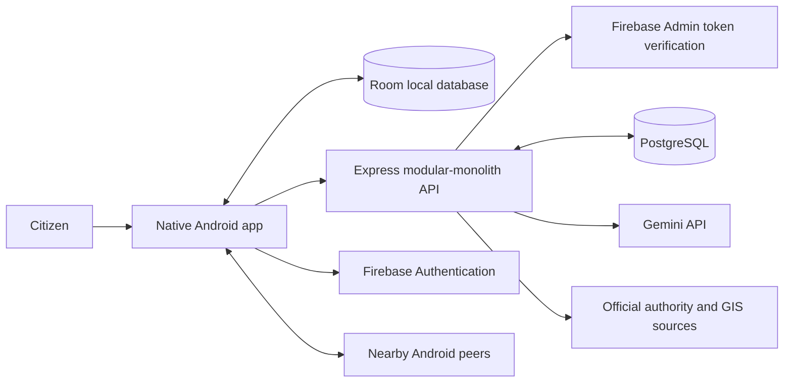

# CityFix — Architecture Overview

## 1. Product scope

CityFix is an Android-first citizen-to-government civic reporting and disaster-awareness platform. Its purpose is to help citizens document local problems, identify potentially responsible authorities using attributable information, and prepare evidence-backed complaints. A separate disaster-management capability is intended to support local coordination when connectivity is degraded.

The native Android application is the primary product. The React/TypeScript browser interface is a separate prototype/reference surface. It must not be described as the primary mobile application.

## 2. Architectural principles

1. **Android-first:** Native Kotlin + Jetpack Compose is the primary citizen experience.
2. **Modular monolith:** Keep the backend deployable as one service with clear internal modules; do not introduce microservices without a demonstrated operational need.
3. **Offline-first capture:** Incident capture and local persistence must not depend on backend availability.
4. **Authority provenance:** Names, jurisdiction, designations, and contacts require attributable sources, timestamps, and verification status.
5. **Human review:** Citizens review and edit generated complaint drafts before sharing.
6. **Explicit state:** Local save, queued, relayed, received, acknowledged, dispatched, and resolved are different states.
7. **Fail closed:** Missing identity, authority, or jurisdiction evidence must result in an unavailable/partial state, not fabricated data or privilege.
8. **Privacy by default:** Minimize personal data and limit precise location and evidence access to authorized purposes.

## 3. System context



**Interpretation:** this is a logical system-context view. Not every edge represents a currently operational integration. See the implementation status below.

## 4. Current implementation status

| Component | Status | Verified boundary |
|---|---|---|
| Native Android shell | Partial / implemented foundation | Kotlin + Compose application exists |
| SOS capture | Implemented foundation | Incident can be saved locally using Room |
| Location | Partial | Recent cached fix may be used; a fresh GPS fix is not guaranteed |
| BLE | Partial | Device capability/adapter checks; no complete peer discovery/relay |
| Wi-Fi Direct / Wi-Fi Aware | Planned / incomplete | No complete peer transport workflow |
| CEMN multi-hop relay | Planned | No verified end-to-end three-device relay |
| Browser UI | Prototype | React/TypeScript surface, separate from native Android |
| Browser Google Maps | Existing integration | Do not infer a native Android map screen from this |
| Express API | Partial | API exists; database-backed capabilities depend on configuration and safeguards |
| Firebase identity | Partial | Client auth and server-side verification paths exist; deployment configuration matters |
| PostgreSQL | Configuration-dependent | Required for durable server-side operations |
| Gemini drafting | Configuration-dependent | Server-side key/model configuration required |
| Authority / jurisdiction | Unavailable until verified sources are configured | API must not invent officials, departments, or boundaries |
| Government submission | Not implemented/verified | No claim of official registration or acknowledgement |
| Emergency dispatch | Not implemented | CityFix is not an emergency dispatch service |

## 5. Application boundaries

### Android client

Responsibilities:
- User-facing reporting and disaster-management screens.
- Permission requests and local device capabilities.
- Incident capture and Room persistence.
- Future peer discovery and transport orchestration.
- Clear delivery-state presentation.

The Android client must not decide whether a user is an official responder based on client-side claims, email strings, or locally editable fields.

### Backend

The backend is a modular monolith. Logical modules include:
- Authentication and identity verification.
- Civic report persistence and access control.
- Authority and jurisdiction source adapters.
- AI-assisted draft generation.
- CEMN event ingestion and synchronization.
- Audit and operational telemetry.

These are logical boundaries, not a claim that every module is complete or independently deployable.

### AI boundary

Gemini may assist with classification, translation, summarization, and complaint-draft generation. It must not:
- Establish a person's official identity or responder authorization.
- Invent jurisdiction, official contacts, or source evidence.
- Decide dispatch, official acknowledgement, or resolution.
- Issue authoritative evacuation instructions.

AI-generated content remains a draft for human review.

## 6. Security boundaries

- Firebase identity tokens must be verified server-side.
- Authorization must be based on trusted server-side role/permission records, not email allowlists or client-supplied role values.
- Citizens may access only reports permitted by the authorization policy.
- Precise coordinates, media, and contact details require least-privilege access.
- CEMN events must be authenticated, integrity-protected, expiry-checked, and deduplicated before trusted state changes.
- API keys and service credentials must remain outside source control and client bundles.
- Security status and known gaps are maintained in [the security baseline](../security/implementation-baseline.md).

## 7. Design target: Android feature organization

The following is a logical target, not a description of the current Gradle module layout:

```text
:app
:core
  :database
  :location
  :network
  :security
  :mesh
    :discovery
    :transport
    :routing
    :message-queue
    :synchronization
:feature
  :auth
  :media
  :authority
  :complaint
  :disaster
    :incident
    :sos
    :offline-map
    :rescue-coordination
```

Current implementation is a single Android application module with internal package boundaries. Split Gradle modules only when ownership, build isolation, or dependency constraints justify the additional complexity.

## 8. Key architecture decisions

| Decision | Rationale |
|---|---|
| Native Android is primary | Matches the product's Android-first scope |
| Backend is a modular monolith | Keeps deployment and operations simple |
| Room stores local incidents | Supports capture when backend connectivity is absent |
| BLE/Wi-Fi are transports, not mesh logic | Routing, TTL, deduplication, authentication, and acknowledgements belong to the application protocol |
| Official data requires provenance | Prevents false authority and jurisdiction claims |
| AI output is advisory | Preserves citizen and authorized-human decision authority |
| Explicit delivery states | Prevents local persistence or relay from being misrepresented as emergency response |

## 9. Related documents

- [Team setup guide](../TEAM_SETUP_GUIDE.md)
- [Contribution workflow](../CONTRIBUTING.md)
- [Report, SOS, and CEMN workflows](workflows.md)
- [Disaster management, GPS, and CEMN details](disaster-management-gps-cemn.md)
- [Security implementation baseline](../security/implementation-baseline.md)
