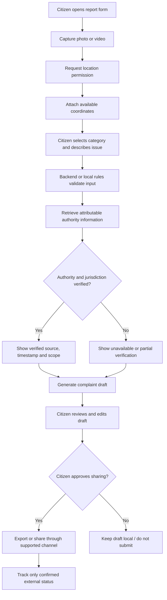
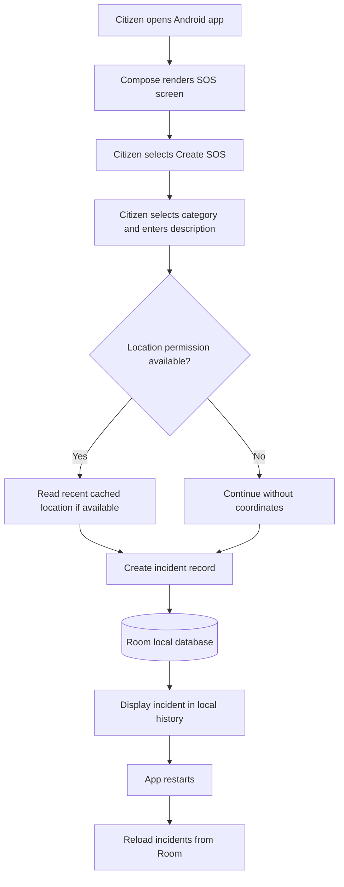
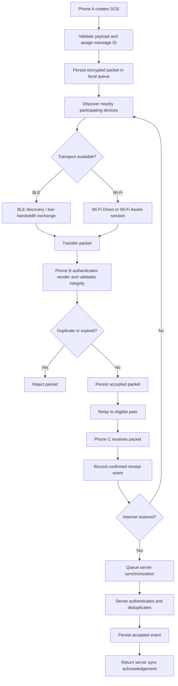
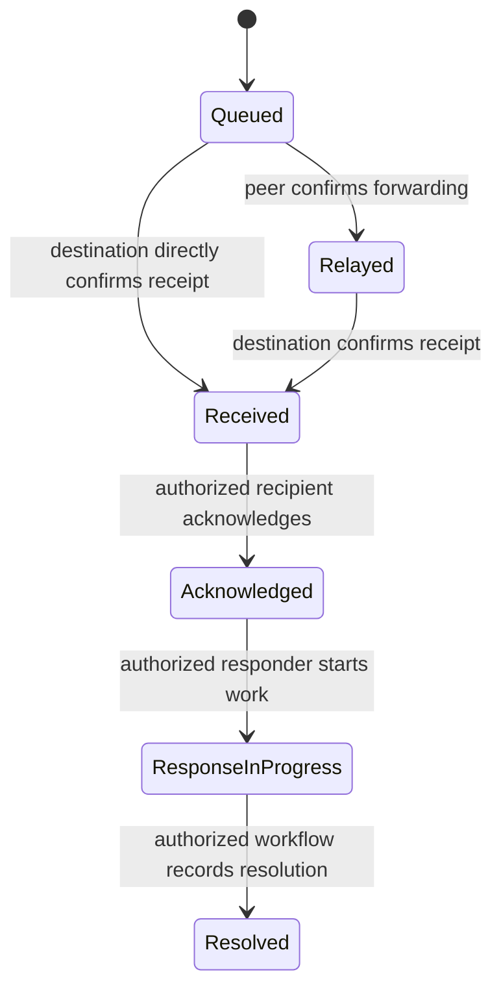
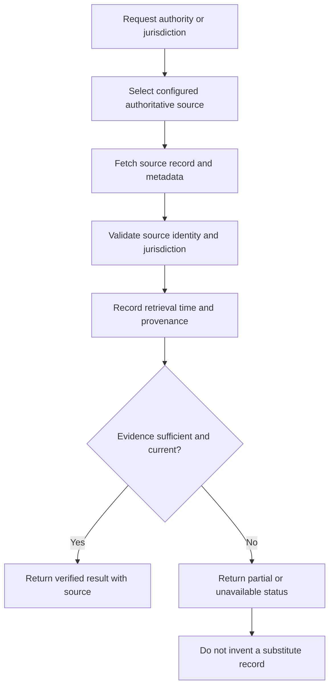

# CityFix — Feature and Workflow Reference

This document separates currently implemented workflows from intended workflows. Mermaid diagrams are included as editable source and render on supported GitHub Markdown surfaces.

## 1. Civic report lifecycle

### Target workflow

### Current boundary

This is the product workflow target. The current repository does not establish a verified government ERP submission or acknowledgement integration. A generated draft or exported document is not proof of official submission.

## 2. Current Android SOS local-capture workflow

**What this proves:** local incident persistence on the device.

**What this does not prove:** network delivery, BLE broadcast, peer discovery, multi-hop relay, responder receipt, emergency dispatch, or agency acknowledgement.

## 3. Intended CEMN offline relay workflow

<badge>Target architecture — not yet end-to-end implemented</badge>

### Protocol requirements

- Globally unique message identifier.
- Sender/device identity bound to a cryptographic key.
- Message integrity verification and authenticated origin.
- Encryption for sensitive content and coordinates.
- Expiry / time-to-live (TTL).
- Duplicate suppression and replay protection.
- Durable local queue and bounded retry/backoff.
- Delivery acknowledgements tied to actual receiver events.
- Server-side authorization before trusted status changes.
- Data minimization and retention limits.
- Android background-execution and battery constraints.

BLE and Wi-Fi provide transport capabilities. They do not supply application-level multi-hop routing, store-and-forward, trust, deduplication, or acknowledgements automatically.

## 4. Delivery state machine

| State | Exact meaning |
|---|---|
| Queued | Persisted locally and waiting for an attempt |
| Relayed | A participating peer confirmed forwarding |
| Received | Destination confirmed packet receipt |
| Acknowledged | Authorized recipient explicitly acknowledged |
| Response in progress | Authorized responder recorded work started |
| Resolved | Authorized workflow recorded resolution with evidence |

A relay is not receipt. Receipt is not acknowledgement. Acknowledgement is not dispatch. Resolution must not be inferred from inactivity or an AI-generated statement.

## 5. Data trust and source status

A cached result is not automatically current or authoritative. Preserve source, retrieval time, geographic scope, and verification status.

## 6. Acceptance tests

### Local incident persistence

1. Install the Android app on a supported device.
2. Create a clearly labelled synthetic SOS.
3. Save it locally.
4. Force-stop and reopen the app.
5. Verify the incident remains visible.
6. Repeat with location permission denied.
7. Verify the app can save without coordinates and does not fabricate a location.

### CEMN three-device acceptance scenario — future

1. Use three physical Android phones A, B, and C.
2. Disable internet on all three.
3. Create an SOS on A.
4. Verify B receives and relays it.
5. Verify C receives it through B.
6. Replay the same packet and verify deduplication.
7. Submit an expired packet and verify rejection.
8. Restore internet and synchronize queued data.
9. Verify server deduplication and truthful acknowledgement states.

Do not mark CEMN operational until this scenario and relevant negative tests pass on physical devices.
